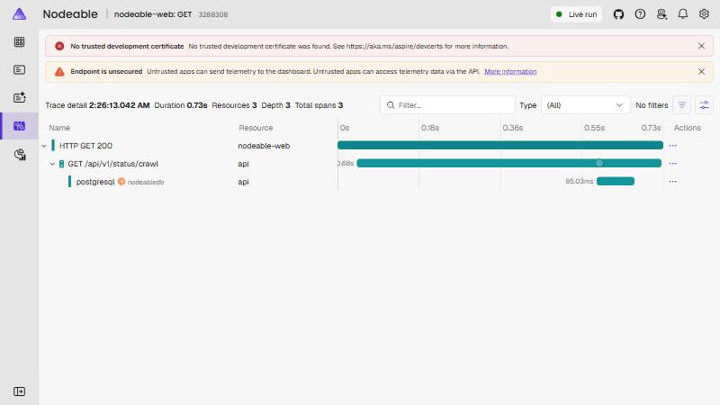

# LG-01: Foundations

## 1. What was built

**Requirements delivered:** NFR-OBS-01, NFR-REL-01 (foundation), NFR-REL-02, NFR-SEC-01, NFR-SEC-04, NFR-A11Y-01, NFR-A11Y-02, NFR-PERF-04, FR-ABOUT-01 (partial). The data model also lays the foundation for FR-GRAPH-01, FR-GRAPH-03, FR-HUB-01, FR-HUB-02 and FR-SEARCH-01.

Milestone M1 delivers no user-facing music feature. It delivers the platform every later feature stands on. One command (`dotnet run --project src/Nodeable.AppHost`) starts PostgreSQL, Redis, an Api, a Worker and a React app, all orchestrated by Aspire. The database schema from spec section 8 exists as an EF Core migration. The web app has a dark-first studio theme, routing and an About page that shows the live queue depth read from the database through the Api, using TypeScript types generated from the Api's OpenAPI document. Most importantly, one click in the browser now appears as a single trace in the Aspire dashboard, running from the browser through the Api to PostgreSQL. GitHub Actions builds, tests, lints and audits both halves of the project on every pull request, and builds these guides as PDFs.

## 2. Architecture slice

Only the components M1 touched are shown. The Worker is a heartbeat for now; the crawl queue consumer and Redis usage arrive in M2.

```text
Browser (React, MUI, TanStack Query)
   │ /api/...                          /otlp/v1/traces   (SDK loaded after first paint)
   ▼                                        │
Vite dev server: same-origin proxy ─────────┼───────────► Aspire dashboard (OTLP)
   │ /api                                                     ▲        ▲
   ▼                                                          │        │
Api (Minimal API, EF Core) ──► PostgreSQL            telemetry │        │ telemetry
   └─────────────────────────────────────────────────────────┘        │
Worker (heartbeat span and log in M1) ─────────────────────────────────┘

AppHost: starts and wires all of the above, plus Redis (not used until M2)
```

One request, from the About page to the database:

1. The browser requests `/api/v1/status/crawl` on its own origin. The tracing instrumentation adds a `traceparent` header.
2. Vite proxies the request to the Api, using the address Aspire injected into its environment.
3. The Api's server span continues the browser's trace and runs the endpoint handler.
4. The handler counts pending rows in `crawl_jobs` through EF Core; Npgsql records a `postgresql` span.
5. The response is typed by the generated OpenAPI contract, and TanStack Query puts it in the cache.
6. The browser's batched spans go to `/otlp/v1/traces`, which Vite forwards to the dashboard, where all three spans appear as one trace.

## 3. Code map

Generated with `tools/learning/collect-anchors LG-01`. Links point to the commit above, so they never go stale.
Do not edit between the two markers: `tools/learning/build` replaces the table with a fresh one pinned to the release commit every time the PDF is built.

<!-- code-map:start -->

| Anchor | File and lines | What it does | Concept it teaches |
| --- | --- | --- | --- |
| `build-time-openapi` | [`src/Nodeable.Api/Nodeable.Api.csproj#L5-L9`](https://github.com/aakif-quayyum/Nodeable/blob/c19b14e7e4a6ed0b36a1c6500a3699146ea49478/src/Nodeable.Api/Nodeable.Api.csproj#L5-L9) | `<OpenApiGenerateDocuments>true</OpenApiGenerateDocuments>` | With these two properties, every build also writes the OpenAPI document to disk (by starting the app's startup code up to Build() and asking it to describe itself), so the web app can generate its TypeScript types without a running server |
| `aspire-ef-integration` | [`src/Nodeable.Api/Program.cs#L11-L14`](https://github.com/aakif-quayyum/Nodeable/blob/c19b14e7e4a6ed0b36a1c6500a3699146ea49478/src/Nodeable.Api/Program.cs#L11-L14) | `builder.AddNpgsqlDbContext<NodeableDbContext>(` | AddNpgsqlDbContext registers the DbContext with the connection string Aspire injected, plus a database health check and Npgsql traces and metrics, in one call |
| `json-number-handling` | [`src/Nodeable.Api/Program.cs#L18-L20`](https://github.com/aakif-quayyum/Nodeable/blob/c19b14e7e4a6ed0b36a1c6500a3699146ea49478/src/Nodeable.Api/Program.cs#L18-L20) | `builder.Services.ConfigureHttpJsonOptions(options =>` | ASP.NET's web defaults also accept numbers written as strings ("5"), and OpenAPI then describes every number as "integer or string"; Strict says numbers are numbers, so the generated TypeScript type is plain `number` |
| `service-wiring` | [`src/Nodeable.AppHost/AppHost.cs#L11-L15`](https://github.com/aakif-quayyum/Nodeable/blob/c19b14e7e4a6ed0b36a1c6500a3699146ea49478/src/Nodeable.AppHost/AppHost.cs#L11-L15) | `var api = builder.AddProject<Projects.Nodeable_Api>("api")` | WithReference injects the connection string as configuration (ConnectionStrings__nodeabledb) and WaitFor holds the service back until the database reports healthy |
| `partial-unique-index` | [`src/Nodeable.Infrastructure/Persistence/Configurations/CrawlJobConfiguration.cs#L19-L22`](https://github.com/aakif-quayyum/Nodeable/blob/c19b14e7e4a6ed0b36a1c6500a3699146ea49478/src/Nodeable.Infrastructure/Persistence/Configurations/CrawlJobConfiguration.cs#L19-L22) | `builder.HasIndex(j => new { j.Kind, j.TargetMbid })` | The unique index only covers pending and running rows, so the same fetch can never be queued twice while it is outstanding, yet finished jobs stay as history and the same target can be fetched again later (NFR-REL-01) |
| `idempotent-upsert` | [`src/Nodeable.Infrastructure/Persistence/Configurations/CreditConfiguration.cs#L25-L27`](https://github.com/aakif-quayyum/Nodeable/blob/c19b14e7e4a6ed0b36a1c6500a3699146ea49478/src/Nodeable.Infrastructure/Persistence/Configurations/CreditConfiguration.cs#L25-L27) | `builder.HasIndex(c => new { c.PersonMbid, c.SubjectType, c.SubjectMbi…` | This unique index makes a re-crawl safe: inserting the same credit twice conflicts instead of duplicating, so the Worker can use INSERT ... ON CONFLICT DO NOTHING |
| `value-converter` | [`src/Nodeable.Infrastructure/Persistence/Conversions/LowerCaseEnumConverter.cs#L9-L13`](https://github.com/aakif-quayyum/Nodeable/blob/c19b14e7e4a6ed0b36a1c6500a3699146ea49478/src/Nodeable.Infrastructure/Persistence/Conversions/LowerCaseEnumConverter.cs#L9-L13) | `public sealed class LowerCaseEnumConverter<TEnum>() : ValueConverter<…` | A ValueConverter translates between a C# type and a database column type in both directions; here enum <-> text, so rows stay readable in psql and not tied to enum declaration order |
| `raw-sql-migration` | [`src/Nodeable.Infrastructure/Persistence/Migrations/20261009113647_InitialCreate.cs#L287-L299`](https://github.com/aakif-quayyum/Nodeable/blob/c19b14e7e4a6ed0b36a1c6500a3699146ea49478/src/Nodeable.Infrastructure/Persistence/Migrations/20261009113647_InitialCreate.cs#L287-L299) | `migrationBuilder.Sql("""` | EF cannot model a SQL view, so the migration runs hand-written SQL: credits live at three levels (recording, work, release) and this view flattens them into "who is credited on this recording", which every graph feature reads (spec section 8) |
| `service-defaults` | [`src/Nodeable.ServiceDefaults/Extensions.cs#L14-L18`](https://github.com/aakif-quayyum/Nodeable/blob/c19b14e7e4a6ed0b36a1c6500a3699146ea49478/src/Nodeable.ServiceDefaults/Extensions.cs#L14-L18) | `public static class Extensions` | One shared project holds telemetry, health and resilience setup, so the Api and Worker call a single AddServiceDefaults() instead of repeating it |
| `otel-signals` | [`src/Nodeable.ServiceDefaults/Extensions.cs#L46-L61`](https://github.com/aakif-quayyum/Nodeable/blob/c19b14e7e4a6ed0b36a1c6500a3699146ea49478/src/Nodeable.ServiceDefaults/Extensions.cs#L46-L61) | `builder.Services.AddOpenTelemetry()` | Metrics and traces are configured side by side; .NET calls a span an Activity and a tracer an ActivitySource, so AddSource opts a source in to export |
| `typed-linting` | [`web/eslint.config.js#L17-L18`](https://github.com/aakif-quayyum/Nodeable/blob/c19b14e7e4a6ed0b36a1c6500a3699146ea49478/web/eslint.config.js#L17-L18) | `tseslint.configs.recommendedTypeChecked,` | "TypeChecked" rules ask the TypeScript compiler for the real type of each expression, so they can catch bugs plain syntax rules cannot, such as an un-awaited Promise or an `any` leaking into typed code |
| `late-bound-fetch` | [`web/src/api/client.ts#L8-L11`](https://github.com/aakif-quayyum/Nodeable/blob/c19b14e7e4a6ed0b36a1c6500a3699146ea49478/web/src/api/client.ts#L8-L11) | `fetch: (request) => globalThis.fetch(request),` | openapi-fetch copies globalThis.fetch when the client is created, but tracing replaces globalThis.fetch after first paint (ADR 0002); looking it up on every call means requests made by an already-created client still pass through the instrumentation and carry a traceparent header |
| `module-augmentation` | [`web/src/app/mui.d.ts#L1-L2`](https://github.com/aakif-quayyum/Nodeable/blob/c19b14e7e4a6ed0b36a1c6500a3699146ea49478/web/src/app/mui.d.ts#L1-L2) | `import type {} from '@mui/material/themeCssVarsAugmentation'` | TypeScript merges declarations of the same interface across files, so importing MUI's augmentation re-opens its Theme interface and adds colorSchemes and a fully typed theme.vars; plain JavaScript has no equivalent because nothing there describes types |
| `deferred-import` | [`web/src/main.tsx#L12-L22`](https://github.com/aakif-quayyum/Nodeable/blob/c19b14e7e4a6ed0b36a1c6500a3699146ea49478/web/src/main.tsx#L12-L22) | `afterFirstPaint(() => {` | A dynamic import() becomes its own JavaScript chunk that is downloaded only when this line runs, so the OpenTelemetry SDK is kept out of the main bundle and loaded after first paint (ADR 0002); requests made before it arrives are not traced |
| `otel-web-sdk` | [`web/src/telemetry/tracing.ts#L18-L25`](https://github.com/aakif-quayyum/Nodeable/blob/c19b14e7e4a6ed0b36a1c6500a3699146ea49478/web/src/telemetry/tracing.ts#L18-L25) | `export function startTracing(exporter: SpanExporter = new OTLPTraceEx…` | The browser SDK has the same three parts as the server: a provider that creates spans, an exporter that ships them over OTLP/HTTP, and instrumentation that creates spans for you (here, every fetch) and adds the W3C traceparent header so the Api's span becomes a child of the browser's |

<!-- code-map:end -->

## 4. Annotated walkthrough

Five anchors were chosen because each shows a decision that is easy to get wrong, rather than a framework feature that is easy to look up. The code map lists all 15 anchors that stay in the code, so the other 10 are one click away; the 41 anchors that explained basic idioms moved into section 5.

### 4.1 `service-defaults`: one place for telemetry, health checks and resilience

```csharp
public static TBuilder AddServiceDefaults<TBuilder>(this TBuilder builder)
    where TBuilder : IHostApplicationBuilder
{
    builder.ConfigureOpenTelemetry();
    builder.AddDefaultHealthChecks();

    builder.Services.AddServiceDiscovery();

    builder.Services.ConfigureHttpClientDefaults(http =>
    {
        http.AddStandardResilienceHandler();
        http.AddServiceDiscovery();
    });

    return builder;
}
```

- **`this TBuilder builder`:** an extension method. It appears on the builder itself, so `builder.AddServiceDefaults()` reads like a method the builder always had.
- **`where TBuilder : IHostApplicationBuilder`:** the same constraint accepts the web builder (Api) and the generic host builder (Worker), and returning `TBuilder` keeps calls chainable. Without the generic, the Worker could not share this.
- **`ConfigureOpenTelemetry` and `AddDefaultHealthChecks`:** logs, metrics and traces are configured here once, so a new service gets them by calling one method.
- **`ConfigureHttpClientDefaults`:** every `HttpClient` created through dependency injection gets a retry, timeout and circuit-breaker pipeline. In M2 the MusicBrainz client replaces it with the spec's own policy (NFR-RATE-03).
- **What would break:** if the Api and Worker each configured telemetry themselves, the setups would drift, and one of them would eventually be missing traces.

### 4.2 `service-wiring`: the whole system as typed C#

```csharp
var api = builder.AddProject<Projects.Nodeable_Api>("api")
    .WithReference(nodeableDb)
    .WaitFor(nodeableDb)
    .WithHttpHealthCheck("/health");

builder.AddViteApp("web", "../../web")
    .WithReference(api)
    .WaitFor(api);

builder.AddProject<Projects.Nodeable_Worker>("worker")
    .WithReference(nodeableDb)
    .WithReference(redis)
    .WaitFor(api)
    .WaitFor(redis);
```

- **`Projects.Nodeable_Api`:** a type Aspire generates from the project reference, so renaming or deleting the Api is a compile error here, not a runtime surprise.
- **`WithReference(nodeableDb)`:** injects the connection string as configuration (`ConnectionStrings__nodeabledb`). The service never contains a password or host name.
- **`WaitFor`:** holds a service back until its dependency is healthy. The Worker waits for the Api because the Api applies the database migrations in Development (decision 0003); without it the two would race.
- **`WithReference(api)` on the web app:** this is how Vite learns the Api's address (`services__api__http__0`), which `vite.config.ts` uses as its proxy target (decision 0004).

### 4.3 `partial-unique-index` and `idempotent-upsert`: rules the database enforces

```csharp
// crawl_jobs: the same fetch is never queued twice while it is outstanding
builder.HasIndex(j => new { j.Kind, j.TargetMbid })
    .IsUnique()
    .HasFilter("status IN ('pending', 'running')");

// credits: inserting the same credit again conflicts instead of duplicating
builder.HasIndex(c => new { c.PersonMbid, c.SubjectType, c.SubjectMbid, c.Role, c.Detail })
    .IsUnique();
```

- **`.HasFilter("status IN ('pending', 'running')")`:** the uniqueness only applies to outstanding jobs. Finished jobs stay as history, and the same recording can be fetched again later (for example a 30-day cache refresh), which a plain unique index would forbid.
- **Why a database rule and not an `if` in C#:** two Api instances can check "is it queued?" at the same moment and both say no. A unique index cannot be raced (NFR-REL-01).
- **The `credits` index and `Detail`:** a re-crawl can then use `INSERT ... ON CONFLICT DO NOTHING`. It only works because `Detail` is never null: PostgreSQL treats NULLs as distinct in a unique index, so a null detail would let duplicates in.
- **How it is tested:** `NFR_REL_01_crawl_job_cannot_be_queued_twice_while_pending_but_can_be_again_once_done` and `FR_GRAPH_03_duplicate_credit_is_rejected_even_when_detail_is_empty` run against a real PostgreSQL container.

### 4.4 `late-bound-fetch`: a bug that makes no noise

```ts
export function createApiClient(baseUrl: string = window.location.origin) {
  return createClient<paths>({
    baseUrl,
    fetch: (request) => globalThis.fetch(request),
  })
}
```

- **`createClient<paths>`:** generic over the types generated from the Api's OpenAPI document, so a wrong path or a misread response field is a compile error.
- **`fetch: (request) => globalThis.fetch(request)`:** `openapi-fetch` copies `globalThis.fetch` when the client is created. Tracing replaces `globalThis.fetch` *after first paint* (decision 0002). A client created earlier would keep calling the original, and its requests would carry no `traceparent` header, with no error anywhere.
- **What would break:** the trace would silently start at the Api instead of the browser. `NFR_OBS_01 sends a traceparent header on Api requests made by a client created before tracing started` exists to fail in that case, and does when the line is removed.
- **The general lesson:** code that patches a global (here `fetch`) only affects callers that look the global up at call time.

### 4.5 `otel-web-sdk`: the same three parts as the server

```ts
export function startTracing(exporter: SpanExporter = new OTLPTraceExporter({ url: OTLP_TRACES_URL })): Tracing {
  const provider = new WebTracerProvider({
    resource: resourceFromAttributes({ 'service.name': 'nodeable-web' }),
    spanProcessors: [new BatchSpanProcessor(exporter)],
  })
  provider.register()

  const unregisterInstrumentations = registerInstrumentations({
    tracerProvider: provider,
    instrumentations: [new FetchInstrumentation({ ignoreUrls: [/\/otlp\//] })],
  })
  // ...
}
```

- **`WebTracerProvider` with `service.name`:** the provider creates spans, and the resource name is what the dashboard shows as the service (`nodeable-web`).
- **`BatchSpanProcessor`:** buffers spans and sends them together, so the browser does not make one network request per span.
- **`FetchInstrumentation`:** creates a span for every `fetch` and adds the W3C `traceparent` header, which is what makes the Api's span a child of the browser's.
- **`ignoreUrls: [/\/otlp\//]`:** the exporter's own POSTs must not be traced, or every export would create a span that needs exporting.
- **`/otlp/v1/traces`, a same-origin URL:** the browser never learns where telemetry is collected, and no CORS rules are needed (decision 0004).

## 5. New concepts from a JavaScript point of view

Each row takes one idea from this code and sets it beside what you would use in JavaScript or Node.js. *In JavaScript* says what you would write there. *Key difference* is the thing to remember: the point where assuming it works like JavaScript would mislead you.

### C# and .NET language ideas

| Concept | In JavaScript / Node.js | In this code | Key difference |
| --- | --- | --- | --- |
| Nullable reference types | TypeScript's `strictNullChecks` stops `string` from including `null`. Plain JavaScript checks nothing: any value can be `null` or `undefined`. | `Directory.Build.props` turns on `<Nullable>enable</Nullable>` for every project. `string` is never null; `string?` might be. | It is a compile-time check only, as in TypeScript. Here warnings are treated as errors, so a possible null fails the build instead of showing up as a runtime crash. |
| `async` / `await` and `Task` | `async` functions return a Promise, and `await` unwraps it. | `CrawlWorker.ExecuteAsync` is `async Task`, and the tests are `async Task` methods. | The idea is the same, but there is no single event loop. A `Task` is scheduled on the .NET thread pool, and the code after an `await` can resume on any pool thread, so shared mutable state needs care. Cancellation is explicit (see `CancellationToken`). |
| LINQ lambdas that become SQL | `array.filter(x => x.status === 'pending').length` runs the function in memory. | `db.CrawlJobs.CountAsync(job => job.Status == CrawlJobStatus.Pending, ct)` in `StatusEndpoints.cs`. | On a `DbSet` the lambda is not executed. EF Core reads its structure (an *expression tree*) and writes it as SQL: `WHERE status = 'pending'`. `EnumColumn.cs` uses the same `Select` on a plain list, in memory: identical syntax, different meaning. |
| Top-level statements | An `index.js` whose statements run top to bottom: `const app = express(); app.listen(3000)`. | `src/Nodeable.Api/Program.cs` is only statements, with `await` allowed at the top level. | C# used to need a `class Program` with a `static void Main`. The compiler now generates it. The file is still compiled, so it must build before it can run. |
| The builder: configure, `Build()`, `Run()` | Express gives you one `app` object, and you call `app.use` and `app.get` on it in any order. | `WebApplication.CreateBuilder` → `AddServiceDefaults` and `AddNpgsqlDbContext` → `Build()` → map endpoints → `Run()`. | There are two phases. Before `Build()` you register services in the dependency-injection container; `Build()` freezes it. You cannot register more afterwards. Express has no such container. |
| Extension methods and generic constraints | Adding a helper to a prototype (`Array.prototype.last = ...`), or just a function `addServiceDefaults(builder)`. TypeScript writes constraints as `<T extends X>`. | `AddServiceDefaults<TBuilder>(this TBuilder builder) where TBuilder : IHostApplicationBuilder` in `Extensions.cs`. | It is compile-time sugar. `builder.AddServiceDefaults()` is rewritten to a plain static call and nothing is added to the type. `this` marks the first parameter, and `where` is the constraint. |
| Records | A frozen object literal, or a TypeScript type with `readonly` fields. | `CrawlStatusResponse` is a one-line `record` with three fields. | A record compares by **value**: two with the same fields are `==`, while two JavaScript objects with the same fields are not (`===` compares identity). It is immutable by default and has a generated `ToString` and a `with` expression to copy and change. |
| Class versus record for entities | A Sequelize or TypeORM model class: a mutable instance per row. | `Recording`, `Person` and the other entities are plain `class`es in `Nodeable.Domain`. | EF Core tracks each loaded row as one object and changes it in place. A record's value equality and immutability fight that model, so entities are classes. |
| `init`, `set` and `required` | A TypeScript `readonly` property assigned in the constructor, or a non-optional field in an interface. | `Recording.Mbid { get; init; }` against `Title { get; set; }`, both marked `required`. | `init` can only be assigned while the object is being created, so the key cannot change. `required` makes the compiler reject any `new Recording { }` that leaves the property out. |
| `CancellationToken` | An `AbortSignal` passed to `fetch`. | `CrawlWorker` passes `stoppingToken` to `Task.Delay`. The status endpoint receives a token that is cancelled if the client disconnects. | Nothing is cancelled unless you pass the token into every `await`. Cancelling throws `OperationCanceledException`, which you catch the way you would catch an `AbortError`. |
| `Activity`, `ActivitySource` and `?.` | An OpenTelemetry span from `tracer.startSpan(...)`, which is a no-op span when no SDK is installed. | `CrawlWorker.Beat` calls `_activitySource.StartActivity("worker.heartbeat")` and then `activity?.SetTag(...)`. | .NET names a span an `Activity` and a tracer an `ActivitySource`. `StartActivity` returns `null` when nothing is listening, so `?.` (optional chaining, exactly as in JavaScript) skips the call. `using var` ends the span when the scope ends. |
| Source-generated logging | `logger.info({ intervalSeconds }, 'heartbeat')` with pino: a message plus structured fields. | `[LoggerMessage] private static partial void LogHeartbeat(...)` in `CrawlWorker.cs`. | `partial` plus an attribute means the compiler writes the method body at build time (a *source generator*; JavaScript has no equivalent). `{IntervalSeconds}` is stored as a named field, and nothing is allocated when the level is off. |
| Dependency injection lifetimes | Node caches modules, so a `require`d module is effectively a singleton. Libraries such as Awilix add scopes. | `AddNpgsqlDbContext` registers the `NodeableDbContext`. `Program.cs` calls `app.Services.CreateScope()` before using it at startup. | The container decides how long an object lives: *singleton* (one for the app), *scoped* (one per HTTP request) or *transient* (new each time). A DbContext is scoped, so code that runs outside a request must open its own scope first. |

### Build and project tooling

| Concept | In JavaScript / Node.js | In this code | Key difference |
| --- | --- | --- | --- |
| `Directory.Build.props` | A root `tsconfig.base.json` that packages `extends`, or a shared ESLint config. | The root file sets `net10.0`, nullable and warnings-as-errors for every project. | MSBuild finds the nearest such file by itself, so no project has to say `extends`. Nearest wins, which is why `tests/Directory.Build.props` imports the root one explicitly. |
| Central package management | npm workspaces with one lockfile, plus root `overrides`. | `Directory.Packages.props` lists every NuGet version once. `.csproj` files name packages without versions. | Transitive pinning lets one line raise a package no project references directly. We pinned EF Core that way so the Npgsql provider's lower minimum could not cause version skew. |
| One config for Vite and Vitest | Jest has its own config and Babel setup, separate from webpack. | `web/vite.config.ts` holds the `test` block beside the app's own settings. | Tests are built with the same plugins and module resolution as the app, so tests and the app cannot disagree about how code is compiled. |
| ESLint flat config | The older `.eslintrc` with `extends` arrays. | `web/eslint.config.js` is an array of config objects. | Entries apply in order, later ones override earlier ones, and each can be scoped to certain files. Type-aware rules get their types through `projectService`. |

### Web framework patterns

| Concept | In JavaScript / Node.js | In this code | Key difference |
| --- | --- | --- | --- |
| Route groups | `express.Router()` mounted with `app.use('/api/v1/status', router)`. | `app.MapGroup("/api/v1/status")` in `StatusEndpoints.cs`. | The group is a builder object. Any filter or authorisation you add to it later applies to every endpoint in the group. |
| Minimal API handlers | `(req, res) => res.json(...)`. | `async (NodeableDbContext db, CancellationToken ct) => TypedResults.Ok(...)`. | Parameters are injected by type, so there is no `req` or `res`. The return value is the response. A typed result also tells OpenAPI what the response looks like. |
| Liveness and readiness | A hand-written `/healthz` route. | `/alive` runs only the checks tagged `live`; `/health` also runs the database check and exists only in Development. | Health checks are registered with tags. `AddNpgsqlDbContext` adds the database check for you; nobody writes a `SELECT 1` by hand. |
| `BackgroundService` | A `setInterval`, or a separate worker process such as a BullMQ worker. | `CrawlWorker : BackgroundService`, registered with `AddHostedService`. | The host owns the lifecycle. It starts the service with the app, gives it a stopping token on shutdown and waits for it to finish. |
| The AppHost | `docker-compose.yml`, a few `npm run` scripts joined by `concurrently`, and a `.env`. | `src/Nodeable.AppHost/AppHost.cs`. | It is typed C#. It starts projects and containers, passes connection strings and URLs as environment variables, waits for health and hosts the dashboard. |
| Generated `Projects.` types | A string such as `docker compose up api`. | `Projects.Nodeable_Api` in `AppHost.cs`. | Aspire generates the type from the project reference, so renaming or deleting the Api is a compile error, not a runtime surprise. |
| Running the web app from the AppHost | `npm run dev` in another terminal, with the proxy target hard-coded. | `AddViteApp("web", "../../web").WithReference(api)`. | The AppHost starts it, assigns its port (`PORT`) and passes it the Api's address (`services__api__http__0`) as an environment variable. |

### EF Core and data

| Concept | In JavaScript / Node.js | In this code | Key difference |
| --- | --- | --- | --- |
| `DbContext` | A Prisma client, a Sequelize instance, or a Knex transaction. | `NodeableDbContext` has a `DbSet<T>` per table. | It tracks the changes you make to entities it loaded and writes them in one transaction on `SaveChanges`. It is short-lived, one per request, not a global like a Prisma client. Aspire registers it with pooling and retries for transient failures. |
| Fluent mapping | A Sequelize `define` call or a Prisma schema file. | One `IEntityTypeConfiguration<T>` class per entity under `Persistence/Configurations`, found by `ApplyConfigurationsFromAssembly`. | The mapping lives outside the entity class (no decorators), so `Nodeable.Domain` knows nothing about EF Core. |
| Composite keys | Two columns marked `primaryKey: true` in Sequelize. | `HasKey(rw => new { rw.RecordingMbid, rw.WorkMbid })` in `RecordingWorkConfiguration.cs`. | The key is written as an anonymous object. There is nothing like that syntax in JavaScript. |
| Foreign keys without navigation properties | Prisma always generates relation fields on the model. | `HasOne<Recording>().WithMany().HasForeignKey(...)`. | The foreign key and its cascade rule exist in the database, but the class has no `recording.work` property. Joins are written explicitly. |
| Design-time `DbContext` factory | A `knexfile.js` for the CLI. | `NodeableDbContextFactory.cs`. | `dotnet ef` has to build a context without running the app. The factory uses a placeholder connection string, because creating a migration never connects to a database. |
| Trigram (GIN) index | The same PostgreSQL feature used from Node. | `HasIndex(r => r.Title).HasMethod("gin").HasOperators("gin_trgm_ops")`. | Nothing here is specific to C#. EF writes `CREATE INDEX ... USING gin (title gin_trgm_ops)`, which makes `ILIKE` and similarity search on titles fast, and the migration enables the `pg_trgm` extension. |

### Testing

| Concept | In JavaScript / Node.js | In this code | Key difference |
| --- | --- | --- | --- |
| `WebApplicationFactory` | `supertest(app)`. | `ApiFactory` derives from `WebApplicationFactory<Program>`; `HealthEndpointTests` uses it. | It boots the real app in memory with its real container, so the DI wiring is tested too. `UseSetting` overrides configuration, and the `HttpClient` talks to it with no network port. |
| Assembly fixtures | Jest `globalSetup` and `globalTeardown`. | `PostgresFixture`, registered with `[assembly: AssemblyFixture(...)]`. | xUnit builds it once per test project and injects it into test and fixture constructors, so one PostgreSQL container serves every test class. |
| `ActivityListener` | An in-memory span exporter used in tests. | `CrawlWorkerTests` subscribes to the `Nodeable.Worker` source. | The test subscribes to an `ActivitySource` by name and reads the finished span's name and tags, with no tracing backend involved. |
| MSW | MSW itself, or `nock` in Node tests. | `web/src/test/server.ts` and `handlers.ts`. | This is the JavaScript tool. `onUnhandledRequest: 'error'` makes any request without a matching handler fail the test, so no test can reach a real server by accident. |
| Fixtures typed by the contract | A plain object that quietly drifts from the real API. | `crawlStatusFixture` is typed `components['schemas']['CrawlStatusResponse']`. | When the Api changes, regenerating the types makes the fixture stop compiling, instead of the test passing against a stale shape. |

### TypeScript and React

| Concept | In JavaScript / Node.js | In this code | Key difference |
| --- | --- | --- | --- |
| The `!` non-null assertion | Nothing: JavaScript has no types to override. | `document.getElementById('root')!` in `main.tsx`. | It is a promise to the compiler and nothing more. It is erased at build time, and if the promise is wrong you get the same runtime `TypeError` JavaScript would give you. |
| `as const` and `(typeof x)[number]` | `Object.freeze(['producer', 'songwriter'])`, with no type information. | `creditRoles` in `creditRoles.ts`. | One array provides both the runtime values and the union type `'producer' \| 'songwriter' \| ...`, so the list and the type cannot drift apart. |
| `Record<K, V>` and exhaustiveness | A lookup object, where a missing key is just `undefined` at runtime. | `creditRoleStyles: Record<CreditRoleKey, CreditRoleStyle>`. | A role without an entry is a compile error, so adding a role to the list forces you to style it. |
| A client typed by generated paths | `fetch('/api/...')` returns untyped JSON. | `createClient<paths>` in `client.ts`; `apiClient.GET('/api/v1/status/crawl')`. | The types come from the Api's OpenAPI document. A wrong path or a misread field is a compile error, and `fetchRatePerMinute` is `number \| null`, not just `number`. |
| Server state versus UI state | Redux thunks, or RTK Query. | `QueryClientProvider` in `providers.tsx` and the `useCrawlStatus` hook. | TanStack Query owns the cache, the loading and error flags and refetching. Components read `isPending`, `isError` and `data`; they do not copy server data into `useState`. |
| Lazy routes | `React.lazy(() => import('./About'))` wrapped in `Suspense`. | `{ path: 'about', lazy: () => import('../features/about/AboutPage.tsx') }` in `router.tsx`. | The router does the lazy loading: the module loads when the route is visited, must export `Component`, and Vite emits it as its own chunk. A loading bar shows while it downloads. |
| MUI colour schemes | Hand-written CSS custom properties and a class toggled on `<body>`. | `colorSchemes: { dark, light }` in `theme.ts`, and `ThemeToggle`. | One theme holds both palettes. MUI turns them into CSS variables and switches them with a data attribute, so the page restyles from the variables. |
| The dev proxy | CRA's `proxy` setting, webpack's `devServer.proxy`, or `http-proxy-middleware` in Express. | `server.proxy` in `vite.config.ts` forwards `/api` and `/otlp`. | The browser only ever sees its own origin, so there are no CORS rules to write. Caddy will do the same job in production. |

**The concept that is least like JavaScript: dependency injection.** In Node there is no container. A module is created once when it is first `require`d, so everything is effectively a singleton and "lifetime" is not a thing you think about. In ASP.NET Core you register services, and the container hands them to constructors and endpoint parameters. The container also decides how long each object lives. The `NodeableDbContext` is *scoped*: one instance per HTTP request, which is what you want, because a context tracks changes and is not safe to share between requests. That is why startup code in `Program.cs`, which runs outside any request, has to call `CreateScope()` itself. If you forget and the context ends up a singleton, you get shared state across requests and bugs that only show up under load. Once you see "who creates this object and how long does it live?" as a question the framework answers, most of the rest of the Api code becomes easy to read.

## 6. Run it and break it

**Run it.** Docker must be running.

```bash
dotnet run --project src/Nodeable.AppHost
```

What you should see:

1. The dashboard at <http://localhost:15180> lists six resources: `postgres` (with its `nodeabledb` database), `redis`, `api`, `worker` and `web`, plus a `web-installer` that finishes quickly. If the table first says "0 resources", reload.
2. The `web` row's link opens the app. The About page shows **"0 jobs waiting"** and two **"Not measured yet"** figures.
3. Under Traces you find a `nodeable-web: GET` trace. Navigate Home, then About, so the request happens after tracing has loaded.

Run the checks:

```bash
dotnet test
cd web && npm test
node --test "tools/learning/*.test.mjs"
```

**Tests that cover it.** The names carry the requirement ID, so a search for an ID finds them.

| Layer | Names |
| --- | --- |
| Api and database (xUnit, Testcontainers) | `NFR_REL_02_alive_endpoint_reports_healthy`, `NFR_REL_02_health_endpoint_includes_the_database_check_in_development`, `NFR_REL_02_unknown_path_returns_not_found`, `FR_ABOUT_01_crawl_status_counts_only_pending_jobs`, `FR_ABOUT_01_crawl_status_reports_unmeasured_values_as_null_not_zero`, `FR_ABOUT_01_openapi_document_describes_the_crawl_status_endpoint` |
| Schema (xUnit, Testcontainers) | `FR_GRAPH_01_migration_creates_all_mvp_tables_and_the_recording_people_view`, `FR_HUB_02_recording_people_view_flattens_credits_from_recording_work_and_release`, `FR_GRAPH_03_duplicate_credit_is_rejected_even_when_detail_is_empty`, `FR_GRAPH_03_roles_are_stored_as_lower_case_text_and_read_back_as_enums`, `FR_GRAPH_03_unknown_enum_text_is_rejected_by_the_check_constraint`, `NFR_REL_01_crawl_job_cannot_be_queued_twice_while_pending_but_can_be_again_once_done` |
| Worker (xUnit) | `NFR_OBS_01_worker_emits_a_heartbeat_span_when_started`, `NFR_REL_01_worker_stops_promptly_when_cancellation_is_requested` |
| Web (Vitest, MSW) | the `NFR_A11Y_01`, `NFR_A11Y_02`, `FR_ABOUT_01`, `NFR_OBS_01` and `NFR_PERF_04` tests under `web/src` |

**Break it on purpose.** Each experiment below was tried while building M1, and the test named is the one that failed. Make the change, run the test, and compare with the expected result. Undo the change afterwards with `git restore`.

| # | Change | Expected result | What it teaches |
| --- | --- | --- | --- |
| 1 | In `web/src/api/client.ts`, delete the line `fetch: (request) => globalThis.fetch(request),`. | `npm test` fails `NFR_OBS_01 sends a traceparent header on Api requests made by a client created before tracing started`: the captured `traceparent` is `null` instead of matching `00-<32 hex>-<16 hex>-01`. | Code that patches a global (here `fetch`) only affects callers that look it up at call time. A client that copied the original at creation silently sends untraced requests, with no error. |
| 2 | In `src/Nodeable.Api/Endpoints/StatusEndpoints.cs`, replace `CountAsync(job => job.Status == CrawlJobStatus.Pending, cancellationToken)` with `CountAsync(cancellationToken)`. | `dotnet test` fails `FR_ABOUT_01_crawl_status_counts_only_pending_jobs`: expected `2`, actual `4` (the test seeds two pending, one running and one done job). | The database is real, so a wrong filter shows up as wrong numbers. A fake could not catch this. |
| 3 | In `web/src/features/about/AboutPage.tsx`, make `formatRate` return `'0 per minute'` when the value is `null`. | `npm test` fails `FR_ABOUT_01 shows unmeasured figures as "Not measured yet", never as zero`: only one "Not measured yet" is found where two are expected. | "Unmeasured" and "zero" are different facts (principle 5). The type `number \| null` exists so the UI has to choose, and a test pins the choice. |
| 4 | In `web/src/app/creditRoles.ts`, change the instrument's dark colour from `'#6ee7a0'` to `'#2a3140'`. | `npm test` fails `NFR_A11Y_02 keeps every role colour at 3:1 or better on the dark backgrounds` with "instrument on default: expected 1.43 to be greater than or equal to 3". | Accessibility rules can be tests. The contrast ratio is computed from the real colours, so a theme change cannot quietly make the graph unreadable. |

## 7. Read the trace



This is the trace for the About page's request, captured in the Aspire dashboard (Traces, then the `nodeable-web: GET` entry). It has three spans in one trace, and the header says "Resources 3, Depth 3, Total spans 3". The timings below were measured once, in development, on a warm stack.

| Span | What happened | Typical duration |
| --- | --- | --- |
| `HTTP GET 200` (resource `nodeable-web`) | The **root**. The browser's fetch instrumentation created this span when the About page asked for `/api/v1/status/crawl`, and added the `traceparent` header to the request. It ends when the response arrives, so it covers everything below it plus the hop through the Vite proxy. | about 0.73 s |
| `GET /api/v1/status/crawl` (resource `api`) | ASP.NET Core's automatic server span. It read the `traceparent` header, so it is a **child** of the browser's span in the same trace. It covers routing, creating the `DbContext`, running the handler and writing the JSON response. | about 0.68 s |
| `postgresql` (resource `api`, database `nodeabledb`) | Npgsql's span for the one query the handler runs: counting pending rows in `crawl_jobs`. It is a child of the Api span and is recorded by the Api process, which is why its resource is `api`. | about 85 ms |

How to read it:

- **The browser span is longer than the Api span** by about 50 ms. That is the time outside the Api: the browser, the Vite proxy hop and the network.
- **Most of the Api span is not the database.** About 0.6 s of the 0.68 s is outside the `postgresql` span. That is one-time warm-up, typically the .NET JIT compiling the code path and EF Core preparing the query for the first time. It was measured: on a fresh start, six consecutive requests straight to the Api took about 820 ms for the first and about 35 ms each for the other five. If a later request were still slow, the gap between the Api span and its child is the first place to look.
- **Why the trace only exists after you navigate to About.** The OpenTelemetry SDK is loaded after first paint (decision 0002). If you load `/about` directly, the first request is made before the SDK arrives and is not traced. Clicking from Home to About makes the request after tracing is running.
- **Why there are two `nodeable-web: GET` traces in the dashboard.** React's StrictMode mounts, unmounts and remounts components once in development, so the page asks twice. TanStack Query cancels the first request through its abort signal, so one of the two traces ends in an abort. The browser's network log shows the same pair: one request cancelled, one `200`.

## 8. Decisions and trade-offs

The full reasoning for each decision is in its record under `docs/spec/decisions/`.

| Decision | Alternatives considered | Why this one | Decision record |
| --- | --- | --- | --- |
| Lint with ESLint 9 and type-checked typescript-eslint | Keep oxlint; Biome; ESLint 10 | Type-aware rules catch un-awaited Promises and `any` leaking into typed code, and they teach TypeScript. ESLint 10 was ruled out because the accessibility plugin does not declare support for it. | `docs/spec/decisions/0001-eslint-with-typescript-eslint.md` |
| Keep the 250 KB budget; split by route and defer the OpenTelemetry SDK | Raise the budget; put OpenTelemetry in the main bundle; drop browser tracing | The budget stays a real constraint. Deferring the SDK moved about 23 KB off the critical path, at the cost that a request made before it loads is not traced. | `docs/spec/decisions/0002-bundle-budget-and-loading-strategy.md` |
| Migrations at Api startup in Development only | A separate migration-service project; migrate in every environment; run `dotnet ef` by hand | One command starts the stack, and production keeps the safer separate step. A migration project would be one more thing outside the spec's layout. | `docs/spec/decisions/0003-migrations-at-startup-in-development.md` |
| Same-origin `/api` and `/otlp` through a proxy | Call the Api and the dashboard cross-origin with CORS; proxy only `/api` | There is no CORS to configure, `traceparent` travels same-origin, and the browser never learns where telemetry is collected. | `docs/spec/decisions/0004-same-origin-api-and-telemetry.md` |
| Generate the OpenAPI document at build time and commit the types | Generate from a running Api; do not commit the generated file; hand-write the types | The frontend builds without .NET, a contract change shows up in a diff, and CI fails if the committed types are stale. | `docs/spec/decisions/0005-generated-api-contract.md` |
| Enums as lower-case text with CHECK constraints | Integers; PostgreSQL enum types; text without a constraint | Rows stay readable, the spec's SQL compares against `'recording'`, and the database rejects values no enum member maps to. Native enum types are harder to evolve. | `docs/spec/decisions/0006-enums-stored-as-lowercase-text.md` |
| Hash anonymous graph tokens | Store the token; use a slow password hash | The token is a bearer credential, so a database leak must not expose usable tokens. It is a random 128-bit value, so a fast hash is enough. | `docs/spec/decisions/0007-anonymous-graph-tokens-are-hashed.md` |
| Partial dates keep a precision column | Raw text plus a year; three nullable numbers; keep `date` and accept "1 January" | Sorting stays simple and the UI never claims precision MusicBrainz did not record. | `docs/spec/decisions/0008-partial-dates-keep-their-precision.md` |
| The Api queues only the recording job | Four placeholder jobs; one job doing everything | The work and release IDs are only known from the recording response, and the release step is conditional. Placeholders would break the unique index, and one big job would lose per-step retry. | `docs/spec/decisions/0009-api-queues-only-the-recording-job.md` |
| The `other` role is shown neutrally | Hide it behind a filter; promote common types now | Principle 5: incomplete data is shown, not hidden. Promotion waits for real data that shows which types are common. | `docs/spec/decisions/0010-other-role-is-shown-neutrally.md` |
| A persistent local database from M3 | Ephemeral plus a seed script; a container kept alive between runs | Re-fetching at about one request per second makes losing the cache on every restart expensive. The seed script remains the fallback. | `docs/spec/decisions/0011-persistent-local-database.md` |
| AwesomeAssertions | FluentAssertions 8; FluentAssertions 7; Shouldly; plain `Assert` | Same `.Should()` syntax as the spec and most tutorials, under an Apache-2.0 licence, so there is no commercial-licence question for a portfolio project. | `docs/spec/decisions/0012-awesomeassertions.md` |
| Hold ESLint and TypeScript majors | Force ESLint 10; replace the accessibility plugin; run two linters | The plugin and typescript-eslint do not support newer majors yet. Upgrades should be deliberate, checked at the start of each milestone. | `docs/spec/decisions/0013-hold-eslint-and-typescript-majors.md` |

## 9. Interview talking points

- **30-second version.** "Milestone one built the platform the app stands on. One command starts PostgreSQL, Redis, an API, a worker and a React app under .NET Aspire. The database schema is an EF Core migration, the TypeScript types are generated from the API's OpenAPI document, and one click in the browser shows up as a single trace from the browser through the API to the database. CI builds, tests, lints and audits both halves on every pull request."
- **2-minute version.** "The interesting design choice is that the browser only talks to its own origin. In development Vite proxies `/api` to the API and `/otlp` to the telemetry endpoint, and in production Caddy will do the same, so there is no CORS to configure and the `traceparent` header travels same-origin. A request starts in the browser, where the OpenTelemetry fetch instrumentation creates a span and adds the header. The API's server span continues that trace, and Npgsql adds a database span under it, so one trace shows three layers. The types the browser uses come from the API's OpenAPI document, generated at build time and committed, and CI fails if they drift. The one problem that surprised me was that tracing was silently missing for the typed client, because the client had copied `fetch` before the instrumentation replaced it."
- **Deep dive: the late-bound `fetch` bug.** "`openapi-fetch` takes a reference to `globalThis.fetch` when you create the client. I load the OpenTelemetry SDK after first paint to keep it out of the main bundle, and the SDK works by replacing `globalThis.fetch`. A client created before that point keeps the original function, so its requests carry no `traceparent` and nothing errors: the trace just starts at the API. I fixed it by passing a `fetch` that looks `globalThis.fetch` up on each call, and wrote a test that creates the client first and starts tracing second, which fails without the fix. At a hundred times the scale I would stop exporting every span from every browser: I would sample at the browser, send to an OpenTelemetry Collector rather than straight to a backend, and use tail sampling there so errors and slow traces are always kept."
- **A question they might ask: "How do you know the frontend and backend agree on the API's types?"** "The types are not written by hand. The API writes its OpenAPI document on every build, `openapi-typescript` generates `schema.d.ts` from it, and the typed client and the test fixtures are written against those types. The generated file is committed, and a CI job regenerates it and fails on any difference, so a contract change has to arrive in the same pull request as its types. One detail mattered: ASP.NET's default JSON settings described numbers as 'integer or string', so I set strict number handling to make the generated type a plain `number`."
- **Another: "Why a unique index instead of checking in code?"** "Two API instances can both check 'is this fetch already queued?' and both get 'no'. A partial unique index on the queue table cannot be raced, so the same fetch is never queued twice while it is outstanding. It only covers pending and running rows, so finished jobs stay as history and the same record can be fetched again later."
- **Another: "What would you do differently?"** "I would have written the load-after-first-paint decision down with its cost from the start: a request before the SDK arrives is not traced. It is accepted, but it surprised me during testing because the hidden browser tab did not even start tracing."

## 10. Exercises

Try each one without looking anything up first. The hints are there for when you are stuck.

1. **Add a field end to end.** Add `lastCrawlAt` to the crawl status response and show it on the About page.
   *Hint:* add a `DateTimeOffset?` to the `CrawlStatusResponse` record and query the newest `LockedAt` among `Done` jobs with `MaxAsync` (careful: an empty table has no maximum, so use a nullable result). Run `npm run gen:api` and the generated type changes; your MSW fixture in `handlers.ts` will stop compiling, which tells you what to update. If you forget to regenerate, the `api-contract` CI job fails.
2. **Make it live.** Make the About page refetch the crawl status every 10 seconds, and test it.
   *Hint:* TanStack Query's `useQuery` accepts a `refetchInterval` option in milliseconds. In the test, switch to fake timers with `vi.useFakeTimers()`, change the MSW handler's answer between two responses, and advance time with `await vi.advanceTimersByTimeAsync(10_000)`. Think about what `staleTime` in `queryClient.ts` does to this.
3. **Stretch: a metric.** Publish a `crawl.queue.depth` gauge from the Api (spec section 11) and find it in the dashboard's Metrics page.
   *Hint:* create a `Meter` from `System.Diagnostics.Metrics` and name it with the prefix `Nodeable.`, because `ServiceDefaults` only exports meters matching `Nodeable.*`. An `ObservableGauge<int>` calls your callback when the metric is read, and the callback has no request, so it needs an `IServiceScopeFactory` to get a `DbContext`. Tag the value with the job `kind` and `status`, as the spec's table says.

## 11. Further reading

- [Aspire](https://aspire.dev): how the AppHost, service defaults and the dashboard fit together; start with the orchestration overview.
- [ASP.NET Core minimal APIs](https://learn.microsoft.com/aspnet/core/fundamentals/minimal-apis): handlers, parameter binding and route groups, the model behind `StatusEndpoints.cs`.
- [Dependency injection in ASP.NET Core](https://learn.microsoft.com/aspnet/core/fundamentals/dependency-injection): singleton, scoped and transient lifetimes, which are the least JavaScript-like part of this code.
- [Entity Framework Core](https://learn.microsoft.com/ef/core/): mapping, migrations and value converters.
- [Npgsql Entity Framework Core provider](https://www.npgsql.org/efcore/): the PostgreSQL-specific features used here, such as indexes with operator classes.
- [OpenTelemetry for .NET](https://opentelemetry.io/docs/languages/dotnet/): traces, metrics and logs from the server side.
- [OpenTelemetry for JavaScript](https://opentelemetry.io/docs/languages/js/): the browser SDK and its instrumentations.
- [W3C Trace Context](https://www.w3.org/TR/trace-context/): the specification of the `traceparent` header that joins the browser's span to the Api's.
- [openapi-typescript](https://openapi-ts.dev): generating types from an OpenAPI document, and the companion `openapi-fetch` client.
- [TanStack Query](https://tanstack.com/query/latest): server state, caching and refetching.
- [Material UI](https://mui.com/material-ui/): theming and colour schemes.
- [React Router](https://reactrouter.com): data routers and lazy routes.
- [typescript-eslint](https://typescript-eslint.io): the type-aware lint rules and what each one catches.
- [Vite](https://vite.dev): the dev server, its proxy and how it builds chunks.
- [Vitest](https://vitest.dev): the test runner that shares Vite's configuration.
- [Mock Service Worker](https://mswjs.io): mocking at the network layer, as the web tests do.
- [Testcontainers for .NET](https://dotnet.testcontainers.org): tests against real infrastructure.
- [xUnit.net](https://xunit.net): the test framework, including v3's assembly fixtures.

## 12. Check yourself

Ten short questions. Answer each in a sentence or two out loud or on paper, then turn the page to check.

1. The typed client is created with `fetch: (request) => globalThis.fetch(request)`. Why not just rely on `openapi-fetch`'s default?
2. In `AppHost.cs`, what does `WaitFor(api)` on the `worker` resource achieve, and which decision does it depend on?
3. Why is `credits.detail` never null, and what would happen to re-crawls if it were nullable?
4. The unique index on `crawl_jobs` has a filter. What does `status IN ('pending', 'running')` allow that a plain unique index would forbid, and why not do this check in C#?
5. Why does the Api set `JsonNumberHandling.Strict`, and what would the generated TypeScript type for `queueDepth` have been without it?
6. The startup code in `Program.cs` calls `app.Services.CreateScope()` before resolving the `NodeableDbContext`. Why?
7. Why does the browser send its spans to `/otlp/v1/traces` on its own origin instead of straight to the dashboard?
8. Break a `traceparent` header into its four parts, and say which part makes the Api's span a child of the browser's.
9. `fetchRatePerMinute` is `null` in the response today. What does `null` mean here, and what would be wrong with sending `0`?
10. The About page is a lazy route and the OpenTelemetry SDK loads after first paint. What does each buy, and what is the cost of the second?

### Answers

1. `openapi-fetch` copies `globalThis.fetch` when the client is created. The OpenTelemetry instrumentation replaces `globalThis.fetch` later, after first paint. A client created earlier would keep calling the original function, so its requests would carry no `traceparent` header and nothing would report an error. Looking `fetch` up on every call means the instrumented version is used.
2. It holds the Worker back until the Api reports healthy. It depends on decision 0003: in Development the Api applies the database migrations at startup, so the Worker waits rather than racing the migration and finding no tables.
3. PostgreSQL treats NULLs as distinct in a unique index, so two credits that differ only by a null `detail` would both be accepted. Re-crawls would then insert duplicates instead of conflicting, and `INSERT ... ON CONFLICT DO NOTHING` would not be idempotent. Making it `NOT NULL DEFAULT ''` removes the problem.
4. It allows the same fetch to be queued again once the earlier job is `done` or `failed`, for example a refresh when cached data is more than 30 days old, while still forbidding two outstanding jobs for the same target. Doing the check in C# would be racy: two Api instances can both see "not queued" and both insert, whereas a unique index cannot be raced.
5. ASP.NET Core's default JSON settings accept numbers written as strings, so the OpenAPI schema described numbers as "integer or string" and the generated TypeScript type would have been `number | string`, which defeats a typed contract. Strict handling makes the schema say `integer`, and the type is a plain `number`.
6. A `DbContext` is registered as *scoped*, meaning one per HTTP request. Startup code runs outside any request, so there is no scope to resolve it from. `CreateScope()` opens one by hand, and `using` disposes it afterwards.
7. The browser then only makes same-origin requests, so no CORS rules are needed, `traceparent` travels same-origin, and the browser never learns where telemetry is collected. Vite proxies `/otlp` to the dashboard in development and Caddy will proxy it to the OpenTelemetry Collector in production.
8. `00-<traceId>-<parentSpanId>-<flags>`: the version, the 32-hex-digit trace ID, the 16-hex-digit ID of the parent span, and the flags (whether it is sampled). The trace ID joins the Api's span to the same trace, and the parent span ID makes the Api's span a child of the browser's span.
9. `null` means "not measured yet": the Worker has not recorded the telemetry behind the figure. Sending `0` would claim that the fetch rate was measured and is zero, which is a different and false statement (principle 5, honest data). The About page shows "Not measured yet" for `null`.
10. The lazy route keeps the About page's code out of the main bundle until someone visits it. Loading the SDK after first paint keeps about 23 KB of OpenTelemetry code off the critical path, so the first render is not delayed by it. The cost of the second is that a request made before the SDK arrives is not traced, for example the first call when a user loads `/about` directly.
