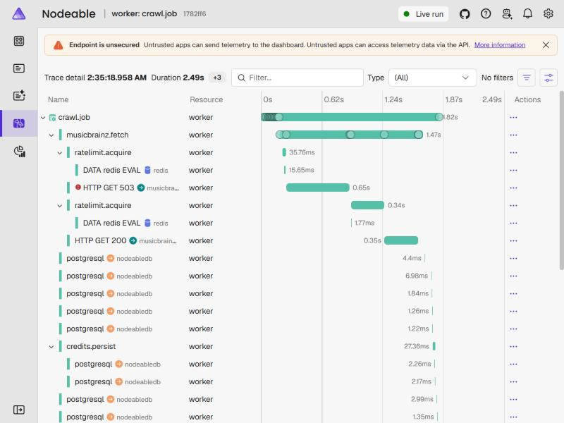

# LG-02: Ingestion

## 1. What was built

**Requirements delivered:** NFR-RATE-01, NFR-RATE-03, NFR-REL-01, FR-GRAPH-03, FR-GRAPH-04 (the status rule; the badge itself is M3), FR-SEARCH-01 (the client and the date handling; the search endpoint is M3), NFR-OBS-01 (extended to jobs and external calls) and NFR-SEC-04 (dependency housekeeping). Decisions 0008, 0009 and 0012 were implemented here, 0013 was extended, and 0014 to 0017 were made.

Milestone M2 turns a MusicBrainz recording ID into stored credits. Given a recording the user wants, the system now fetches the recording, its linked work and (only when needed) one release from MusicBrainz, maps every relationship to one of the app's roles, and stores the people and credits so that re-running changes nothing. It does this at no more than one request per second across all Worker instances, retries a busy MusicBrainz instead of failing, keeps every unfinished job in a PostgreSQL table so that a restart resumes the work, and records one trace that runs from the request that asked for the song through every job it caused.

There is still no screen for this. The REST endpoint that calls `SongIngestionService` and the graph that shows the result are M3. What you can do today is queue a job and watch the Worker, the database and the Aspire dashboard (section 6), and read 170 backend tests, many of which exercise the whole chain against a real PostgreSQL and Redis.

Along the way the milestone also: stored partial MusicBrainz dates with a precision, added AwesomeAssertions and an 80% coverage gate on `Domain`, moved to ESLint 10 with a maintained accessibility plugin (decision 0014), upgraded msw to 3, and fixed two problems that only showed up by running the real stack (section 7).

## 2. Architecture slice

Only what M2 touched. The dashed arrow is the part that arrives in M3.

```text
Api ┄┄► SongIngestionService ──► recordings (stub row) + crawl_jobs (kind=recording)
                                          │
                                          │ FOR UPDATE SKIP LOCKED, highest priority first
                                          ▼
Worker: CrawlWorker ─► CrawlJobRunner ─► handler for the job's kind
                                              │
                    ┌─────────────────────────┴───────────────────────────┐
                    │ MusicBrainzClient                                   │
                    │  total ► retry ► attempt ► RATE GATE ► count ► net   │ ───► MusicBrainz (1 request/s)
                    └─────────────────────────────────────────────────────┘          ▲
                                              │                           Redis: one number per resource
                                              ▼                           (Lua script, Redis's own clock)
        people, credits, works, releases, links  +  follow-up jobs (work, release) in the same trace
```

One song, step by step:

1. `SongIngestionService.RequestAsync` returns at once if credits are already stored. Otherwise it stores a recording stub and queues **one** `recording` job at interactive priority (decision 0009).
2. A Worker claims the job with one atomic statement, restores the trace context stored on it, and starts a `crawl.job` span.
3. `RecordingJobHandler` asks MusicBrainz for the recording. Each HTTP attempt waits for its own slot at the rate gate; a 503 or 429 is retried.
4. The recording, its releases and works and their links, and its recording-level credits are written in one transaction.
5. After the commit the handler queues a `work` job per linked work, and one `release` job (the earliest dated) only when no producer is credited. Each carries the same trace and priority.
6. Those jobs run the same way and store their own credits. The recording's `credits_status` is recomputed after every step.

## 3. Code map

Generated with `tools/learning/collect-anchors LG-02`. Links point to the commit above, so they never go stale.
Do not edit between the two markers: `tools/learning/build` replaces the table with a fresh one pinned to the release commit every time the PDF is built.

<!-- code-map:start -->

| Anchor | File and lines | What it does | Concept it teaches |
| --- | --- | --- | --- |
| `record-struct` | [`src/Nodeable.Domain/Dates/PartialDate.cs#L11-L24`](https://github.com/aakif-quayyum/Nodeable/blob/b688eaede1c9f65db6ce1dbfddb0df0f6c6065e9/src/Nodeable.Domain/Dates/PartialDate.cs#L11-L24) | `public readonly record struct PartialDate(DateOnly Date, DatePrecisio…` | A readonly record struct is a small immutable value type with value equality built in: two PartialDate values with the same date and precision are equal, and it costs no heap allocation |
| `private-setter` | [`src/Nodeable.Domain/Entities/Recording.cs#L30-L37`](https://github.com/aakif-quayyum/Nodeable/blob/b688eaede1c9f65db6ce1dbfddb0df0f6c6065e9/src/Nodeable.Domain/Entities/Recording.cs#L30-L37) | `public void SetFirstReleaseDate(PartialDate? date)` | A private setter lets the type keep two properties consistent: callers can read both but can only change them together through this method, so a date can never exist without its precision |
| `frozen-dictionary` | [`src/Nodeable.Domain/Mapping/RoleMapper.cs#L14-L31`](https://github.com/aakif-quayyum/Nodeable/blob/b688eaede1c9f65db6ce1dbfddb0df0f6c6065e9/src/Nodeable.Domain/Mapping/RoleMapper.cs#L14-L31) | `private static readonly FrozenDictionary<string, CreditRole> _roleByR…` | A FrozenDictionary is built once and never changes, so the runtime can optimise its lookups for reads; a good fit for a lookup table that is fixed for the life of the process |
| `trace-propagation` | [`src/Nodeable.Infrastructure/Crawling/CrawlJobRunner.cs#L47-L53`](https://github.com/aakif-quayyum/Nodeable/blob/b688eaede1c9f65db6ce1dbfddb0df0f6c6065e9/src/Nodeable.Infrastructure/Crawling/CrawlJobRunner.cs#L47-L53) | `_ = ActivityContext.TryParse(job.Traceparent, null, out var parent);` | A trace context saved as text in the database can be turned back into a parent: the job's span joins the trace of the request that queued it, so one trace shows the click and the background fetch it caused |
| `on-conflict-do-nothing` | [`src/Nodeable.Infrastructure/Crawling/CrawlQueue.cs#L36-L43`](https://github.com/aakif-quayyum/Nodeable/blob/b688eaede1c9f65db6ce1dbfddb0df0f6c6065e9/src/Nodeable.Infrastructure/Crawling/CrawlQueue.cs#L36-L43) | `var inserted = await db.Database.ExecuteSqlAsync(` | ON CONFLICT DO NOTHING lets the database's unique index decide "is this already queued?" atomically, so two requests at the same instant cannot both insert; the conflict target repeats the index's WHERE clause so only outstanding jobs count |
| `skip-locked` | [`src/Nodeable.Infrastructure/Crawling/CrawlQueue.cs#L71-L86`](https://github.com/aakif-quayyum/Nodeable/blob/b688eaede1c9f65db6ce1dbfddb0df0f6c6065e9/src/Nodeable.Infrastructure/Crawling/CrawlQueue.cs#L71-L86) | `var claimed = db.CrawlJobs` | FOR UPDATE SKIP LOCKED makes each worker pass over rows another worker is already claiming instead of waiting on them, so any number of workers can pull from one table without a broker, and the claim is a single atomic UPDATE |
| `upsert-unnest` | [`src/Nodeable.Infrastructure/Ingestion/CreditStore.cs#L46-L59`](https://github.com/aakif-quayyum/Nodeable/blob/b688eaede1c9f65db6ce1dbfddb0df0f6c6065e9/src/Nodeable.Infrastructure/Ingestion/CreditStore.cs#L46-L59) | `await db.Database.ExecuteSqlAsync(` | unnest() turns arrays into rows, so a whole response is written with one INSERT ... ON CONFLICT statement instead of a round trip per credit; the unique index makes it safe to run again |
| `typed-client` | [`src/Nodeable.Infrastructure/MusicBrainz/MusicBrainzClient.cs#L16-L20`](https://github.com/aakif-quayyum/Nodeable/blob/b688eaede1c9f65db6ce1dbfddb0df0f6c6065e9/src/Nodeable.Infrastructure/MusicBrainz/MusicBrainzClient.cs#L16-L20) | `public sealed class MusicBrainzClient(HttpClient http) : IMusicBrainz…` | A "typed client" is a class that takes an HttpClient in its constructor; the factory configures that client (base address, User-Agent, handlers) and manages the connection pool, much like a preconfigured axios instance |
| `keyed-service` | [`src/Nodeable.Infrastructure/MusicBrainz/MusicBrainzServiceCollectionExtensions.cs#L30-L38`](https://github.com/aakif-quayyum/Nodeable/blob/b688eaede1c9f65db6ce1dbfddb0df0f6c6065e9/src/Nodeable.Infrastructure/MusicBrainz/MusicBrainzServiceCollectionExtensions.cs#L30-L38) | `services.AddKeyedSingleton<IRateGate>(Source, (provider, _) =>` | A keyed service lets one interface have several registrations told apart by a key, so a second external API (Discogs, v2) can get its own IRateGate without a new interface |
| `resilience-pipeline` | [`src/Nodeable.Infrastructure/MusicBrainz/MusicBrainzServiceCollectionExtensions.cs#L70-L73`](https://github.com/aakif-quayyum/Nodeable/blob/b688eaede1c9f65db6ce1dbfddb0df0f6c6065e9/src/Nodeable.Infrastructure/MusicBrainz/MusicBrainzServiceCollectionExtensions.cs#L70-L73) | `private static void ConfigureResilience(ResiliencePipelineBuilder<Htt…` | A Polly resilience pipeline is built from strategies that wrap each other, outermost first: a total timeout, then retry with exponential backoff and jitter, then a per-attempt timeout |
| `migration-backfill` | [`src/Nodeable.Infrastructure/Persistence/Migrations/20261011160604_PartialDatePrecision.cs#L25-L29`](https://github.com/aakif-quayyum/Nodeable/blob/b688eaede1c9f65db6ce1dbfddb0df0f6c6065e9/src/Nodeable.Infrastructure/Persistence/Migrations/20261011160604_PartialDatePrecision.cs#L25-L29) | `migrationBuilder.Sql("UPDATE recordings SET first_release_date_precis…` | A migration that adds a constraint must first repair rows that would break it; EF generates the schema change but cannot know what a sensible value is for existing data, so this SQL is written by hand |
| `delegating-handler` | [`src/Nodeable.Infrastructure/RateLimiting/RateGateHandler.cs#L7-L15`](https://github.com/aakif-quayyum/Nodeable/blob/b688eaede1c9f65db6ce1dbfddb0df0f6c6065e9/src/Nodeable.Infrastructure/RateLimiting/RateGateHandler.cs#L7-L15) | `internal sealed class RateGateHandler(IRateGate gate) : DelegatingHan…` | A DelegatingHandler is middleware for an HttpClient: each handler wraps the next one, like Express middleware, so cross-cutting work such as waiting for a rate slot or counting requests stays out of the client code |
| `lua-token-bucket` | [`src/Nodeable.Infrastructure/RateLimiting/RedisRateGate.cs#L18-L33`](https://github.com/aakif-quayyum/Nodeable/blob/b688eaede1c9f65db6ce1dbfddb0df0f6c6065e9/src/Nodeable.Infrastructure/RateLimiting/RedisRateGate.cs#L18-L33) | `private static readonly LuaScript _script = LuaScript.Prepare("""` | A Lua script runs atomically inside Redis, so "read the bucket, decide, write it back" cannot interleave with another instance's call; the clock is Redis's own TIME, so machines with skewed clocks still agree |
| `activity-source` | [`src/Nodeable.Infrastructure/Telemetry/InfrastructureTelemetry.cs#L15-L16`](https://github.com/aakif-quayyum/Nodeable/blob/b688eaede1c9f65db6ce1dbfddb0df0f6c6065e9/src/Nodeable.Infrastructure/Telemetry/InfrastructureTelemetry.cs#L15-L16) | `public static readonly ActivitySource ActivitySource = new(Name);` | An ActivitySource is .NET's tracer: StartActivity returns null when nobody is listening, so tracing costs nothing until an exporter subscribes |
| `background-service` | [`src/Nodeable.Worker/CrawlWorker.cs#L11-L17`](https://github.com/aakif-quayyum/Nodeable/blob/b688eaede1c9f65db6ce1dbfddb0df0f6c6065e9/src/Nodeable.Worker/CrawlWorker.cs#L11-L17) | `public sealed partial class CrawlWorker(` | BackgroundService turns a long-running loop into a hosted service: the host calls ExecuteAsync at startup and cancels its token at shutdown, which is how a .NET worker is stopped cleanly (like handling SIGTERM in Node) |

<!-- code-map:end -->

## 4. Annotated walkthrough

Five of the 15 anchors were chosen because each shows a decision that is easy to get wrong. The code map lists all 15. Three anchors that explained small language features were removed (`or-pattern`, `try-parse`, `linq-order-stable`) and are covered in section 5.

### 4.1 `skip-locked` and `on-conflict-do-nothing`: a queue in one table

```csharp
// CrawlQueue.EnqueueAsync
var inserted = await db.Database.ExecuteSqlAsync(
    $"""
    INSERT INTO crawl_jobs (kind, target_mbid, priority, status, attempts, run_after, traceparent)
    VALUES ({kindText}, {targetMbid}, {priority}, 'pending', 0, now(), {traceparent})
    ON CONFLICT (kind, target_mbid) WHERE status IN ('pending', 'running') DO NOTHING
    """,
    cancellationToken);
```

```csharp
// CrawlQueue.ClaimNextAsync
var claimed = db.CrawlJobs
    .FromSql(
        $"""
        UPDATE crawl_jobs
        SET status = 'running', locked_by = {workerId}, locked_at = now(), attempts = attempts + 1
        WHERE id = (
            SELECT id FROM crawl_jobs
            WHERE status = 'pending' AND run_after <= now()
            ORDER BY priority DESC, run_after ASC
            LIMIT 1
            FOR UPDATE SKIP LOCKED)
        RETURNING *
        """)
    .AsNoTracking()
    .AsAsyncEnumerable();
```

- **`ON CONFLICT (kind, target_mbid) WHERE status IN ('pending', 'running') DO NOTHING`:** the conflict target repeats the partial unique index from M1, so only outstanding jobs conflict. The database decides "is this already queued?", and two requests at the same instant cannot both insert. The number of rows changed tells the caller which happened.
- **`WHERE id = (SELECT ... FOR UPDATE SKIP LOCKED)`:** the inner query picks the best pending row and locks it; any other worker running the same statement skips locked rows instead of waiting, and takes the next one. The outer `UPDATE` marks it running in the same statement, so there is no gap between "choose" and "claim".
- **`ORDER BY priority DESC, run_after ASC`:** interactive work (priority 100) overtakes background work (10); inside a priority, the longest-waiting job goes first.
- **`now()` everywhere:** the database's clock decides what is due and when a lock expired, so workers on machines with skewed clocks agree.
- **`.AsAsyncEnumerable()`:** tells EF Core not to wrap the statement in a `SELECT`, which an `UPDATE ... RETURNING` cannot sit inside.
- **What would break:** without `SKIP LOCKED` the second worker blocks on the first one's row. `NFR_REL_01_claim_skips_a_row_another_worker_holds_instead_of_waiting_for_it` holds a row in an open transaction and fails when the clause is removed.

### 4.2 `lua-token-bucket`: one rule for every instance

```csharp
// RedisRateGate
private static readonly LuaScript _script = LuaScript.Prepare("""
    local interval = tonumber(@interval)
    local burst = tonumber(@burst)
    local maxWait = tonumber(@maxWait)
    local t = redis.call('TIME')
    local now = t[1] * 1000 + math.floor(t[2] / 1000)
    local tat = tonumber(redis.call('GET', @key))
    if tat == nil or tat < now then tat = now end
    local wait = tat - (burst - 1) * interval - now
    if wait < 0 then wait = 0 end
    if wait > maxWait then return -1 end
    local newTat = tat + interval
    redis.call('SET', @key, newTat, 'PX', newTat - now + interval)
    return wait
    """);
```

```csharp
// RedisRateGate.AcquireAsync
var reply = await redis.GetDatabase().ScriptEvaluateAsync(
    _script,
    new
    {
        key = _key,
        interval = (long)options.Interval.TotalMilliseconds,
        burst = options.Burst,
        maxWait = (long)options.MaxWait.TotalMilliseconds,
    });
```

- **The bucket is one number:** the time at which it would be full again (the "theoretical arrival time"). A request takes the earliest free slot and moves that number forward by one interval. With a burst of 1 and an interval of one second, requests are one second apart.
- **`wait = tat - (burst - 1) * interval - now`:** how long this caller must wait for its slot. The caller then sleeps exactly that long. Nobody polls, and every waiter has its own place in line.
- **`if wait > maxWait then return -1`:** refuse instead of queueing for ever, and do not move the number, so a refused caller does not use up a slot.
- **`redis.call('TIME')`:** the clock is Redis's own, so Workers on different machines agree.
- **`tonumber(...)`:** Redis hands script arguments to Lua as strings. The first version compared a string with a number and failed on the very first test against a real Redis, with `attempt to compare string with number`.
- **Why a script:** "read the bucket, decide, write it back" as three separate commands could interleave with another instance's three. A script runs as one step inside Redis.
- **How it is tested:** `NFR_RATE_01_two_instances_share_one_budget` uses two separate connections as two Workers and asserts that six requests need five intervals, not two.

### 4.3 `resilience-pipeline`: the gate goes inside the retry

```csharp
// MusicBrainzServiceCollectionExtensions.AddMusicBrainz
#pragma warning disable EXTEXP0001
client.RemoveAllResilienceHandlers();
#pragma warning restore EXTEXP0001
client.AddResilienceHandler("musicbrainz", ConfigureResilience);
client.AddHttpMessageHandler(provider => new RateGateHandler(provider.GetRequiredKeyedService<IRateGate>(Source)));
client.AddHttpMessageHandler(() => new ExternalRequestMetricsHandler(Source));
```

```csharp
// MusicBrainzServiceCollectionExtensions.ConfigureResilience
private static void ConfigureResilience(ResiliencePipelineBuilder<HttpResponseMessage> pipeline, ResilienceHandlerContext context)
{
    var options = context.ServiceProvider.GetRequiredService<IOptions<MusicBrainzOptions>>().Value;

    pipeline
        .AddTimeout(options.TotalTimeout)
        .AddRetry(new HttpRetryStrategyOptions
        {
            MaxRetryAttempts = options.MaxRetries,
            Delay = options.RetryBaseDelay,
            BackoffType = DelayBackoffType.Exponential,

            // Jitter spreads retries from many instances so they do not all come back at the same instant.
            UseJitter = true,

            // A Retry-After header, when the server sends one, replaces the calculated delay.
            ShouldRetryAfterHeader = true,

            // NFR-RATE-03 names 503 and 429. Network failures and a timed-out attempt are transient in the same way.
            // Other statuses, such as 400 or 404, would fail again the same way, so they are returned as they are.
            ShouldHandle = args => ValueTask.FromResult(args.Outcome switch
            {
                { Result.StatusCode: HttpStatusCode.ServiceUnavailable or HttpStatusCode.TooManyRequests } => true,
                { Exception: HttpRequestException or TimeoutRejectedException } => true,
                _ => false,
            }),
        })
        .AddTimeout(options.AttemptTimeout);
}
```

- **`RemoveAllResilienceHandlers()`:** `ServiceDefaults` gives every `HttpClient` the standard retry, circuit-breaker and timeout handler (LG-01, section 4.1). Leaving it would stack two retry layers, and the number of requests would multiply. The test that counts exactly six attempts (one plus five retries) sees 24 when the line is removed.
- **Handlers run in the order they are added, outermost first.** So the order here is: the Polly pipeline (timeout, retry, per-attempt timeout), then `RateGateHandler`, then the request counter, then the network.
- **Why the gate is inside the retry:** a retry after a 503 is a new request. If the gate sat outside the retry, the retries would skip the line, and MusicBrainz would see bursts at exactly the moment it is struggling. `NFR_RATE_01_and_03_a_retry_goes_back_through_the_gate_for_its_own_slot` fails with "found 1" gate release instead of 2 when the two registrations are swapped.
- **`ShouldHandle` with property patterns:** retry on 503, 429, network failures and a timed-out attempt. 400 and 404 are returned as they are, because they would fail the same way again.
- **`UseJitter`, `ShouldRetryAfterHeader`:** jitter spreads retries from several instances; a `Retry-After` header replaces the calculated delay (`NFR_RATE_03_a_429_waits_for_the_retry_after_header_the_server_sent`).
- **The `#pragma`:** Microsoft marks `RemoveAllResilienceHandlers` as experimental (`EXTEXP0001`). The test is what notices if its behaviour changes.

### 4.4 `trace-propagation`: a trace that survives a database

```csharp
// CrawlQueue.EnqueueAsync
var traceparent = TraceparentOf(activity ?? Activity.Current);

// CrawlQueue
private static string? TraceparentOf(Activity? activity) =>
    activity is { IdFormat: ActivityIdFormat.W3C } ? activity.Id : null;
```

```csharp
// CrawlJobRunner.RunOnceAsync
_ = ActivityContext.TryParse(job.Traceparent, null, out var parent);
using var activity = InfrastructureTelemetry.ActivitySource.StartActivity("crawl.job", ActivityKind.Consumer, parent);
```

- **`TraceparentOf(activity ?? Activity.Current)`:** the W3C `traceparent` of the `crawl.enqueue` span (or, if nobody is listening for spans, of the request that is running) is stored as text in `crawl_jobs.traceparent`.
- **`ActivityContext.TryParse(...)`, then `StartActivity(..., parent)`:** when a Worker picks the job up, possibly minutes later in another process, the text is turned back into a parent. The `crawl.job` span is therefore a child of `crawl.enqueue` in the same trace.
- **A job with no stored context** (queued by something untraced, such as the SQL you type in section 6) starts a trace of its own, which is why section 7's trace is rooted at `crawl.job`.
- **The follow-up jobs** are queued from inside the `crawl.job` span, so `Activity.Current` is that span and they are its children: click, enqueue, job, enqueue, job, one trace (`NFR_OBS_01_the_work_job_is_in_the_trace_of_the_request_that_added_the_song`).

### 4.5 `upsert-unnest`: write a whole response in one statement

```csharp
// CreditStore.PersistAsync
var inserted = await db.Database.ExecuteSqlAsync(
    $"""
    INSERT INTO credits (person_mbid, subject_type, subject_mbid, role, detail, source)
    SELECT t.person_mbid, {subjectTypeText}::text, {subjectMbid}::uuid, t.role, t.detail, 'musicbrainz'
    FROM unnest({credits.Select(c => c.Person.Id).ToArray()}::uuid[],
                {credits.Select(c => ToText(c.Mapped.Role)).ToArray()}::text[],
                {credits.Select(c => c.Mapped.Detail).ToArray()}::text[])
        AS t(person_mbid, role, detail)
    ON CONFLICT (person_mbid, subject_type, subject_mbid, role, detail) DO NOTHING
    """,
    cancellationToken);
```

- **`unnest(array, array, array)`:** turns three arrays into rows, so 16 relationships become one `INSERT` with one round trip, not 16.
- **`::uuid[]`, `::text[]`:** Npgsql sends a .NET array as a PostgreSQL array. The casts tell PostgreSQL which element type to expect.
- **`ON CONFLICT (...) DO NOTHING`:** the unique index on the credits table (M1, `idempotent-upsert`) makes the statement safe to run again. A crashed job that is recovered, or a refresh, inserts nothing new.
- **`credits.Count - inserted`:** the rows that already existed. In the real "Redbone" response, 16 relationships become 15 credits, because one person is credited with `mix` and with `additional mix`, which both map to (mixing, empty detail).
- **Why `detail` is never null:** PostgreSQL treats NULLs as distinct in a unique index. RoleMapper sorts and de-duplicates instrument attributes for the same reason: the same relationship read twice must produce the same `detail`, or the index would not recognise it.
- **What would break:** `NFR_REL_01_running_the_same_jobs_again_changes_nothing`, and with the `ON CONFLICT` line removed, nine ingestion tests fail with `23505: duplicate key value violates unique constraint`.

## 5. New concepts from a JavaScript point of view

Each row takes one idea from this code and sets it beside what you would use in JavaScript or Node.js. *In JavaScript* says what you would write there. *Key difference* is the thing to remember: the point where assuming it works like JavaScript would mislead you. Concepts that LG-01 already covered (nullable reference types, `async`/`await`, dependency injection basics, `CancellationToken`) are not repeated.

### C# language ideas

| Concept | In JavaScript / Node.js | In this code | Key difference |
| --- | --- | --- | --- |
| `readonly record struct` | A frozen object literal, `Object.freeze({ date, precision })`. Two such objects are `===` only if they are the same object, so comparing by content needs `lodash.isEqual` or a hand-written function. | `PartialDate(DateOnly Date, DatePrecision Precision)` and `MappedRole(CreditRole Role, string Detail)`. | Equality by content is built in: two `PartialDate` values with the same date and precision are equal, and `==` says so. A `struct` is copied on assignment instead of referenced, and a `record` cannot be changed after it is created. |
| A private setter that keeps two fields consistent | A `#private` field with a getter, or an object you only change through a function. | `Recording.FirstReleaseDate` and `FirstReleaseDatePrecision` have `private set`; `SetFirstReleaseDate(PartialDate?)` changes both. | Callers can read both properties but can only change them together, so a date can never exist without its precision. EF Core can still fill them from the database. The CHECK constraint in the migration is the backstop for anything that bypasses C#. |
| The `TryParse` pattern and `out` | A function that returns `null` or `{ ok, value }`, or one that throws on bad input. | `PartialDate.TryParse(text, out var date)` returns a `bool` and hands the value back through `out`. | Bad input is an ordinary result, not an exception: no stack trace is built for every malformed date. `out var` declares the variable where it is used, and on `false` it holds `default`. It is the idiom behind `int.TryParse` and `Guid.TryParse` too. |
| Pattern matching: `is A or B`, and property patterns in a `switch` | `role === 'instrument' \|\| role === 'vocal'`, or `switch (true) { case ...: }`. | `role is CreditRole.Instrument or CreditRole.Vocal` in `RoleMapper`, and `{ Result.StatusCode: HttpStatusCode.ServiceUnavailable or HttpStatusCode.TooManyRequests } => true` in the retry's `ShouldHandle`. | A pattern can test a value, look inside an object (`Result.StatusCode`) and combine tests with `or` in one expression. The compiler knows the shapes, so a misspelt property is a compile error. |
| Collection expressions `[...]` and spread `..` | Array literals and `[...a, ...b]`. | `[.. _released.Order()]` in a test, and `[]` for an empty list. | Same look, but the result type comes from the target: the same `[a, b]` is an array, a `List<T>` or an `IReadOnlyList<T>` depending on where it is assigned. |
| `FrozenDictionary` | `Object.freeze(new Map(...))`, which does not stop `.set()`, or a plain object with lower-cased keys. | `RoleMapper._roleByRelationshipType`, built once with `StringComparer.OrdinalIgnoreCase`. | Truly read-only and optimised for lookups after it is built. The comparer is part of the dictionary, so case-insensitive matching needs no `.toLowerCase()` on every key. |
| Interpolated raw strings that become SQL parameters | A template literal; with a tagged template such as ``sql`SELECT ... ${id}` `` from `postgres` the values become parameters. | ``db.Database.ExecuteSqlAsync($"""INSERT ... VALUES ({kindText}, {targetMbid})""")``. | The `$"..."` is passed to a method that takes a `FormattableString`, so each `{...}` becomes a parameter and is never pasted into the text. The same `$"..."` passed to a method that takes a plain `string` would be string concatenation. EF Core names the safe one `ExecuteSql` and the unsafe one `ExecuteSqlRaw`. |
| `LoggerMessage` source generation | `logger.info({ jobId, kind }, 'job done')` with pino. | `[LoggerMessage(...)] private static partial void LogDone(...)` in `CrawlJobRunner`. | You write an empty `partial` method and a compiler plug-in generates the body at build time. Parameters stay structured and are not formatted unless that log level is on. |
| `internal` and `InternalsVisibleTo` | A module's non-exported functions; a test imports from a deep path or the function is exported "for tests". | `InfrastructureTelemetry` is `internal`; the test project may see `MusicBrainzClient.Quote` through `<InternalsVisibleTo>`. | `internal` means "this assembly", not "this file", and an assembly is a project. Tests live in another assembly, so access is granted explicitly. |
| `TimeSpan` | A number of milliseconds, with the unit in a variable name. | `RetryBaseDelay`, `LockTimeout`, `TimeSpan.FromSeconds(5)`. | The unit is part of the type. It binds from configuration as `"00:00:30"` (hours:minutes:seconds), which is why the tests write `"00:00:00.010"`. |

### HTTP and resilience

| Concept | In JavaScript / Node.js | In this code | Key difference |
| --- | --- | --- | --- |
| A typed `HttpClient` | `axios.create({ baseURL, headers })`, or a class that wraps `fetch`. | `MusicBrainzClient(HttpClient http)`, registered with `AddHttpClient<IMusicBrainzClient, MusicBrainzClient>`. | The factory builds the `HttpClient`, pools and recycles the connections underneath, and applies the base address, `User-Agent` and handlers. You never write `new HttpClient()` per call, which would exhaust sockets. |
| `DelegatingHandler` | An axios interceptor, or a function that wraps `fetch`. | `RateGateHandler` waits for the gate and then calls the next handler; `ExternalRequestMetricsHandler` counts the result. | Handlers form a chain in registration order, outermost first, and the position is the design: a gate inside the retry behaves differently from one outside it. |
| A resilience pipeline | `p-retry`, `async-retry` or `cockatiel`. | `AddResilienceHandler("musicbrainz", ...)`: total timeout, retry, per-attempt timeout. | Strategies wrap each other like handlers. The retry looks at the *response* (`503`) as well as at exceptions, can honour `Retry-After`, and has jitter built in. The library is Polly. |
| The options pattern | `process.env.X` parsed by `zod` or `envalid` at start-up. | `MusicBrainzOptions` bound from the `MusicBrainz` section, with `ValidateDataAnnotations().ValidateOnStart()`. | A typed object, bound from any configuration source (JSON, environment, user secrets). Validation runs when the host starts, so a missing contact URL stops the app at once instead of failing on the first request. |
| Keyed services | A `Map<string, Client>` or a factory function. | `AddKeyedSingleton<IRateGate>("musicbrainz", ...)` and `AddKeyedScoped<ICrawlJobHandler, RecordingJobHandler>(CrawlJobKind.Recording)`. | One interface, several registrations, told apart by a key (a string or an enum). The runner asks for `GetKeyedService<ICrawlJobHandler>(job.Kind)`. |

### Background work and dependency lifetimes

| Concept | In JavaScript / Node.js | In this code | Key difference |
| --- | --- | --- | --- |
| `BackgroundService` | A `while (true)` loop in a worker process with a `SIGTERM` handler that sets a flag. | `CrawlWorker : BackgroundService`; the loop ends when `stoppingToken` is cancelled. | The host owns the lifecycle. It passes a cancellation token to `ExecuteAsync`, cancels it at shutdown, and waits for the method to return. |
| A scope per job inside a singleton | A per-request container, for example an `awilix` scope. | `CrawlJobRunner` is a singleton and calls `CreateAsyncScope()` for every job. | See the paragraph below the tables. |
| Cancellation that must not cancel the clean-up | An `AbortSignal` passed to `fetch`; clean-up after an abort needs a fresh controller. | After shutdown, the runner releases the job with `CancellationToken.None`, not the cancelled token. | A cancelled token makes every call that uses it throw. The "give the job back" statement has to run *after* cancellation, so it must not use the same token. |
| `Task.WhenAll` | `Promise.all`. | The tests start eight claimers with `Task.WhenAll(...)`. | The same idea. A `Task` that throws surfaces its exception when awaited; `WhenAll` rethrows the first and keeps the others on the aggregate. |

### EF Core, SQL and Redis

| Concept | In JavaScript / Node.js | In this code | Key difference |
| --- | --- | --- | --- |
| Raw SQL through the ORM | `knex.raw(...)` or `pg`'s `client.query(...)`. | `ExecuteSqlAsync` for statements, `FromSql(...).AsAsyncEnumerable()` for an `UPDATE ... RETURNING`, `SqlQuery<T>` for scalars. | `FromSql` maps the returned columns onto an entity by name. EF wraps `FromSql` in a `SELECT` unless you stop it, which is what `.AsAsyncEnumerable()` is for here. |
| A transaction and an execution strategy | `knex.transaction(async trx => ...)`. | `db.Database.CreateExecutionStrategy().ExecuteAsync(async () => { BeginTransactionAsync ... })` in each handler. | Aspire turns on connection retries. EF refuses a bare transaction then, because it may need to run the whole block again, so the block must be safe to repeat. The handlers are idempotent for that reason (and for crash recovery). |
| A migration that repairs data | A knex migration with `knex.raw`. | `PartialDatePrecision` runs two `UPDATE`s with `migrationBuilder.Sql` before it adds the CHECK constraints. | EF generates the schema change but cannot know what value existing rows deserve. Adding a constraint to a table that already has rows needs that repair first; a test migrates a database only as far as the first migration, adds a row, then migrates on. |
| Lua in Redis | `ioredis`'s `defineCommand({ numberOfKeys, lua })`. | `LuaScript.Prepare(...)` with `@name` placeholders, run with `ScriptEvaluateAsync`. | Arguments arrive in Lua as strings, so numbers need `tonumber(...)`. Comparing a string with a number fails at run time, in Redis, not at compile time. |
| `ON CONFLICT` and a unique index as the lock | A check, then an insert, in code, or a library lock. | `INSERT ... ON CONFLICT DO NOTHING`, with the partial unique index doing the deciding. | Two instances checking in code can both see "not there". The index cannot be raced, so the database is the only place the rule is enforced. |

### Observability and testing

| Concept | In JavaScript / Node.js | In this code | Key difference |
| --- | --- | --- | --- |
| `ActivitySource` and `Activity` | `tracer.startActiveSpan(...)` from `@opentelemetry/api`. | `InfrastructureTelemetry.ActivitySource.StartActivity("crawl.job", ActivityKind.Consumer, parent)`. | Tracing is in the .NET runtime itself, not a library. `StartActivity` returns `null` when no one is listening, so `activity?.SetTag(...)` costs nothing until an exporter subscribes. |
| Restoring a trace from a stored string | `propagation.extract(context.active(), { traceparent })`. | `ActivityContext.TryParse(job.Traceparent, null, out var parent)`. | The carrier is a database column, not an HTTP header, so nothing extracts it for you; you do it by hand when you pick the job up. |
| `Meter` and `Histogram<T>` | `meter.createHistogram(...)`. | `crawl.job.duration`, `crawl.queue.wait`, `ratelimit.wait`, `external.requests`. | Also built into the runtime. `AddMeter("Nodeable.*")` in `ServiceDefaults` exports every meter whose name starts with `Nodeable.`. |
| WireMock.Net | `nock` or `msw` in Node tests. | `WireMockServer.Start()` serving captured MusicBrainz responses. | It is a real HTTP server on a random port, so the whole `HttpClient` stack runs: handlers, retries, headers. A scenario with states makes a server answer 503, 503, 200 in turn. |
| `ActivityListener`, `MeterListener` and an SDK in a test | An in-memory exporter. | `SpanCollector`, a `MeterListener` in the runner tests, and a real `TracerProvider` in `QueuePollingTraceTests`. | Listeners are part of the runtime, so a test can observe the spans and metrics the code produced without an exporter. A test of *suppression* needs the real SDK, because the SDK honours it. |
| A coverage gate | `jest --coverage` with `coverageThreshold`. | `tools/ci/check-coverage.mjs` reads a Cobertura report and fails under 80% on `Nodeable.Domain`. | A separate script, so it can also fail when the assembly is *missing* from the report. A gate that finds nothing and passes protects nothing. |

### Three small things that were removed from the code as anchors

- **`or-pattern`:** `role is CreditRole.Instrument or CreditRole.Vocal` is the pattern row above. It reads like English and replaces a chain of `===`.
- **`try-parse`:** `PartialDate.TryParse` is the `out` row above. It never throws on bad input, and a malformed date becomes "no date" rather than a wrong one.
- **`linq-order-stable`:** `ReleaseSelector` sorts with `OrderBy(r => r.Date ?? DateOnly.MaxValue)`. LINQ's `OrderBy` is stable, like `Array.prototype.sort` in current JavaScript engines, so releases with the same date keep MusicBrainz's order, and a missing date is mapped to the largest date so undated releases sort last.

### The concept that is least like JavaScript: scoped services inside a singleton

A Node worker usually holds one database client for its whole life. In .NET the `NodeableDbContext` is **scoped**: it is meant to live for one unit of work (one web request, one job), because it tracks entities and holds a connection. The hosted service and the runner, on the other hand, are **singletons**: one instance for the life of the process.

If the singleton asked for a `DbContext` in its constructor, it would keep that one instance for ever. Entities it had tracked would pile up, a connection problem would stay with it, and two overlapping uses would corrupt each other, because a `DbContext` is not thread-safe. The way out is the one `CrawlJobRunner` uses: inject `IServiceScopeFactory`, and create a scope per job with `await using var scope = scopes.CreateAsyncScope()`. Everything resolved from that scope (the `DbContext`, the queue, the handler, the `CreditStore`) is created for that job and disposed when it ends. The rule of thumb: **a long-lived object must not hold a short-lived one; it holds the factory instead.**

## 6. Run it and break it

**Run it.** Docker must be running.

```bash
dotnet run --project src/Nodeable.AppHost
```

There is no endpoint yet that adds a song (M3), so you play the part of the Api and queue the job yourself. Find the PostgreSQL container and its generated password, then insert a job for "Redbone" by Childish Gambino:

```bash
docker ps --filter name=postgres --format "{{.Names}}"
docker exec <container> printenv POSTGRES_PASSWORD
docker exec -e PGPASSWORD=<password> <container> psql -U postgres -d nodeabledb -c "INSERT INTO crawl_jobs (kind, target_mbid, priority, status, attempts, run_after) VALUES ('recording', '7408f11c-6c4e-41e5-b81b-6a15bf6cb268', 100, 'pending', 0, now())"
```

This makes the Worker send **two real requests to MusicBrainz** (the recording, then its work), about a second apart, with the project's User-Agent. Wait a few seconds, then look:

```bash
docker exec -e PGPASSWORD=<password> <container> psql -U postgres -d nodeabledb -c "select id, kind, status, attempts, priority from crawl_jobs order by id"
```

What you should see (this is what the run on 2026-10-12 produced):

| Where | What |
| --- | --- |
| `crawl_jobs` | Two rows: `recording` and `work`, both `done`, `attempts` 1, `priority` 100. The second row is the follow-up the Worker queued, with the priority it inherited. |
| `recordings` | One row, "Redbone", first release date `2016-11-17` with precision `day`, `credits_status` `complete`. |
| Counts | 15 releases, 1 work, 6 people, 15 recording-level credits and 4 work-level credits. |
| Worker logs (dashboard, Console logs) | `Crawl job 1 (recording) done on attempt 1`, then `Crawl job 2 (work) done on attempt 1`. |
| Traces (dashboard) | One trace named `worker: crawl.job` (section 7). An idle Worker produces no traces at all. |

Run the checks:

```bash
dotnet test
cd web && npm test
node --test "tools/learning/*.test.mjs" "tools/ci/*.test.mjs"
```

**Tests that cover it.** The names carry the requirement ID. There are 170 backend tests: 73 in `Nodeable.Domain.Tests`, 86 in `Nodeable.Infrastructure.Tests`, 5 in `Nodeable.Worker.Tests` and 6 in `Nodeable.Api.Tests`. M1 ended with 14 of them, so 156 are new.

| Area | Names (a selection) |
| --- | --- |
| Role mapping and dates (Domain, no Docker) | `FR_GRAPH_03_every_relationship_type_in_the_spec_table_maps_to_its_role`, `FR_GRAPH_03_attribute_order_does_not_change_the_detail_so_a_re_crawl_stays_idempotent`, `FR_SEARCH_01_a_partial_date_becomes_its_earliest_day_with_the_precision_it_was_given`, `FR_GRAPH_04_a_producer_and_a_songwriter_make_the_credits_complete`, `NFR_REL_01_the_wait_doubles_with_each_attempt` |
| Schema and migration | `FR_SEARCH_01_migration_gives_dates_stored_before_it_the_day_precision`, `FR_SEARCH_01_a_date_without_a_precision_is_rejected_by_the_database` |
| MusicBrainz client (WireMock) | `FR_SEARCH_01_every_request_carries_the_user_agent_with_the_configured_contact`, `FR_GRAPH_03_recording_lookup_returns_credits_the_work_link_the_isrc_and_the_releases`, `NFR_RATE_03_gives_up_after_five_retries_and_reports_what_musicbrainz_said`, `NFR_RATE_03_a_429_waits_for_the_retry_after_header_the_server_sent`, `FR_SEARCH_01_the_app_will_not_start_without_a_contact_url` |
| Rate gate (real Redis) | `NFR_RATE_01_concurrent_requests_are_spaced_one_interval_apart`, `NFR_RATE_01_two_instances_share_one_budget`, `NFR_RATE_01_the_gate_refuses_instead_of_queueing_past_its_maximum_wait`, `NFR_RATE_01_and_03_a_retry_goes_back_through_the_gate_for_its_own_slot` |
| Queue (real PostgreSQL) | `NFR_REL_01_claim_skips_a_row_another_worker_holds_instead_of_waiting_for_it`, `NFR_REL_01_many_workers_claiming_at_once_never_get_the_same_job`, `NFR_REL_01_jobs_abandoned_by_a_dead_worker_go_back_to_the_queue`, `NFR_REL_01_a_job_that_keeps_killing_its_worker_is_eventually_failed` |
| Runner and worker loop | `NFR_REL_01_stopping_the_worker_hands_the_running_job_back_without_counting_the_attempt`, `NFR_OBS_01_the_job_span_continues_the_trace_of_the_request_that_queued_it`, `NFR_REL_01_the_worker_stops_promptly_when_cancellation_is_requested`, `NFR_OBS_01_polling_an_empty_queue_does_not_create_database_spans` |
| Whole chain | `FR_GRAPH_03_adding_a_song_stores_the_recording_its_work_releases_and_credits`, `FR_GRAPH_03_credits_are_stored_once_per_person_role_and_detail_at_each_level`, `NFR_REL_01_running_the_same_jobs_again_changes_nothing`, `NFR_REL_01_a_chain_cut_short_by_a_restart_is_finished_by_the_next_process`, `NFR_OBS_01_the_work_job_is_in_the_trace_of_the_request_that_added_the_song` |
| Api side | `FR_GRAPH_03_the_api_never_queues_work_release_or_preview_jobs` |

**Break it on purpose.** Each experiment was run while writing this guide, and the result in the table is what was observed. Make the change, run the test, compare, then undo it with `git restore`.

| # | Change | Expected result | What it teaches |
| --- | --- | --- | --- |
| 1 | In `src/Nodeable.Infrastructure/Crawling/CrawlQueue.cs`, delete `FOR UPDATE SKIP LOCKED` from the claim statement (keep the closing parenthesis). Run `dotnet test --project tests/Nodeable.Infrastructure.Tests --filter-class "*CrawlQueueTests"`. | `NFR_REL_01_claim_skips_a_row_another_worker_holds_instead_of_waiting_for_it` fails after about 10 seconds with `PostgresException : 57014: canceling statement due to user request`. The test holds a row in an open transaction, and without `SKIP LOCKED` the claim waits for it until the test's own timeout cancels it. | `SKIP LOCKED` is the difference between workers that share a table and workers that queue behind each other. A test needs a *held* row to see it. |
| 2 | In `MusicBrainzServiceCollectionExtensions.cs`, comment out `client.RemoveAllResilienceHandlers();`. | `NFR_RATE_03_gives_up_after_five_retries_and_reports_what_musicbrainz_said` fails: `Expected _server.LogEntries to contain 6 item(s), but found 24`. | Two retry layers multiply: the default handler's retries each contain this client's six attempts. |
| 3 | In the same file, move `client.AddHttpMessageHandler(provider => new RateGateHandler(...));` above the line `client.AddResilienceHandler("musicbrainz", ConfigureResilience);`. | `NFR_RATE_01_and_03_a_retry_goes_back_through_the_gate_for_its_own_slot` fails: `Expected gate.ReleasedAt to contain 2 item(s) because the retry acquired a slot of its own, but found 1`. | The position of a handler in the chain is the behaviour. A gate outside the retry lets retries skip the line. |
| 4 | In `RedisRateGate.cs`, replace the three `tonumber(@...)` calls in the script with the bare `@interval`, `@burst` and `@maxWait`. | All eight tests in `RedisRateGateTests` fail with `StackExchange.Redis.RedisServerException : ERR user_script:10: attempt to compare string with number`. | Script arguments are strings. The error comes from Redis at run time, which is why this layer is tested against a real Redis and not a fake. |
| 5 | In `CreditStore.cs`, delete the line `ON CONFLICT (person_mbid, subject_type, subject_mbid, role, detail) DO NOTHING` from the credits `INSERT`. | Nine tests in `CreditIngestionTests` fail; the stored job's `LastError` reads `23505: duplicate key value violates unique constraint "ix_credits_person_mbid_subject_type_subject_mbid_role_detail"`. Even a first import fails, because one person is credited twice with the same role in the real response. | Idempotence is not a nicety here: real data already contains duplicates, and the unique index is what turns them into no-ops. |
| 6 | In `src/Nodeable.Infrastructure/Persistence/Migrations/20261011160604_PartialDatePrecision.cs`, comment out the two `migrationBuilder.Sql(...)` lines. | `FR_SEARCH_01_migration_gives_dates_stored_before_it_the_day_precision` fails with `23514: check constraint "ck_recordings_first_release_date_has_precision" of relation "recordings" is violated by some row`. | A new constraint must be preceded by a repair of the rows that already exist; EF cannot write that part. |
| 7 | In `CrawlQueue.cs`, comment out the two `using var suppressed = SuppressInstrumentationScope.Begin();` lines. | `NFR_OBS_01_polling_an_empty_queue_does_not_create_database_spans` fails because the claim and recovery statements appear among the recorded spans. In the real stack the trace list gains about one trace a second (section 7). | Instrumentation is global by default; a loop that runs every second needs to opt out of it. |

## 7. Read the trace



This is the real `worker: crawl.job` trace from the stack in section 6, in the Aspire dashboard (Traces, then the `worker: crawl.job` row). The job was queued with SQL, so it carries no stored trace context and the trace is rooted at the job. It has 55 spans in one trace and took 2.49 s end to end. Its two jobs spent that time as follows (spans of the same name appear once per job):

| Span | What happened | Duration |
| --- | --- | --- |
| `crawl.job` (recording) | The Worker claimed the job and ran its handler. | 1.82 s |
| `musicbrainz.fetch` | The client's own span: `mb.entity=recording`, with the `inc` parameters. It encloses every attempt. | 1.47 s |
| `ratelimit.acquire` | The first slot. This is the first use of the Redis connection, which is why it is longer than a later gate span; the `DATA redis EVAL` child is the script call itself (16 ms). | 36 ms |
| `HTTP GET 503` | **MusicBrainz answered 503 on the first attempt.** The span is marked as an error, which is why the trace has a red marker in the list. | 0.65 s |
| `ratelimit.acquire` (second) | The retry went back through the gate and waited for its own slot. | 0.34 s |
| `HTTP GET 200` | The retry succeeded. | 0.35 s |
| `postgresql` (five spans) and `credits.persist` | The recording, releases, works and links written in one transaction, then the credits. The same data in a test records `credits.inserted=15` and `credits.duplicates=1` on `credits.persist`, which matches the 15 stored rows. | about 1 to 7 ms each, 27 ms for `credits.persist` |
| `crawl.enqueue` (work) | The follow-up job queued from inside the recording job's span. | 2.9 ms |
| `crawl.job` (work) | The work job: a gate wait of 0.43 s (the slot a second after the recording's last request), one `HTTP GET 200` of 0.17 s, and `credits.persist` in 3.8 ms. It is a child of the `crawl.enqueue` above, so it is part of the same trace. | 0.66 s |

How to read it:

- **The 503 is real and it did not fail the job.** The job's `attempts` is 1: the HTTP layer retried inside one attempt, which is the separation `NFR_RATE_03_busy_responses_are_retried_inside_the_call_without_failing_the_job` tests. The gap between the 503 and the next `ratelimit.acquire` is about 0.1 s, shorter than the configured two-second base delay. That is consistent with MusicBrainz having sent a `Retry-After` header, which replaces the calculated delay, but the headers were not captured, so treat it as a likely explanation, not a measurement.
- **The two `ratelimit.acquire` waits are the rate limit made visible.** The second request of the same job and the first request of the follow-up job were each delayed to leave one second between requests. If these spans grow, the limit is the bottleneck.
- **The cold-start cost is real.** In an earlier measurement with a stand-in server (a WireMock instance in a test), the first HTTP call of a fresh process took 9.4 s and every later one about 3 ms. The first request of a new process pays for JIT compilation and connection set-up; do not read a first trace as typical.
- **A trace that did not exist:** before the fix in `CrawlQueue`, the same dashboard filled with `worker: postgresql` traces with the stack idle, one per poll of the queue: 204 after about three and a half minutes. Section 6, experiment 7, brings it back. The fix suppresses instrumentation for the claim and stale-recovery queries, and an idle Worker now shows nothing.
- **Logging had the same problem.** The same polling logged 58 SQL statements in 30 seconds at the default level. The Worker's `appsettings.json` now sets the EF Core command category to Warning.
- **Stand-in values.** The trace of a test that runs the same chain with a stand-in MusicBrainz and a one-second gate shows the shape without the real service's latency: `crawl.job` (recording) 31 ms with a 1.4 ms gate span (`ratelimit.wait_ms=0`), then the work job at 990 ms, of which `ratelimit.acquire` is 978 ms (`ratelimit.wait_ms=972`).

## 8. Decisions and trade-offs

The full reasoning for each decision is in its record under `docs/spec/decisions/`.

| Decision | Alternatives considered | Why this one | Decision record |
| --- | --- | --- | --- |
| Partial dates keep a precision column (implemented here) | Raw text plus a year; three nullable numbers; keep `date` and accept "1 January" | Sorting stays simple, and the UI never claims precision MusicBrainz did not record. The entity changes both columns together and a CHECK constraint backs it. | `docs/spec/decisions/0008-partial-dates-keep-their-precision.md` |
| The Api queues only the recording job; the Worker queues the rest (implemented here) | Four placeholder jobs; one job doing everything | The work and release IDs are only known from the recording response. The preview job is queued behind a switch until M4 has a handler, and the release decision is made at the recording step (implementation notes in the record). | `docs/spec/decisions/0009-api-queues-only-the-recording-job.md` |
| AwesomeAssertions (implemented here) | FluentAssertions 8; FluentAssertions 7; Shouldly; plain `Assert` | Same `.Should()` syntax as the spec and most tutorials under an Apache-2.0 licence. All backend tests use it, including the existing ones. | `docs/spec/decisions/0012-awesomeassertions.md` |
| Hold TypeScript at 6.0; keep `@types/node` on the runtime's major | Accept `@types/node` 26 on Node 24; move the runtime to Node 26 | The types must describe the runtime that executes the code. Dependabot ignores the major, and the milestone-start check looks at the pin. | `docs/spec/decisions/0013-hold-eslint-and-typescript-majors.md` |
| ESLint 10 with `eslint-plugin-jsx-a11y-x` | Stay on ESLint 9 (end of life); the old plugin on ESLint 10 with the peer warning overridden; drop accessibility linting; run oxlint beside ESLint | ESLint 9 is end of life and the old plugin has not been released since October 2024. The fork has the same 34 recommended rules, and a test proves the four deliberate violations are still caught. | `docs/spec/decisions/0014-eslint-10-and-jsx-a11y-x.md` |
| The credits status is derived from the roles credited | `complete` only when every step finished; `complete` also requires an engineer; a stored "fetched" flag; compute on read | Complete means a producer and a songwriter (the pair FR-GRAPH-04 looks for); partial means something; none means nothing. A song that is not `none` is served from the cache. | `docs/spec/decisions/0015-credits-status-rule.md` |
| A Redis token bucket inside the retry, replacing the default handler | Gate outside the retry; an in-process limiter; a fixed window with `INCR`; a distributed lock; polling for a token; keeping the default handler | A retry is a new request and must wait for its own slot, and N Workers must share one budget. Mutation checks pin both properties. | `docs/spec/decisions/0016-musicbrainz-request-pipeline.md` |
| The crawl queue is a PostgreSQL table claimed with `SKIP LOCKED` | Hangfire for every job; RabbitMQ or MassTransit; Redis lists or streams; `LISTEN/NOTIFY`; select then update | Reliability without a broker at one request per second. The queue is inspectable with SQL, and its state is covered by the same backups and migrations. | `docs/spec/decisions/0017-crawl-queue-on-postgresql.md` |

## 9. Interview talking points

- **30-second version.** "Milestone two is the ingestion pipeline. Given a MusicBrainz recording ID, a background worker fetches the recording, its work and, if needed, a release, maps every relationship to a role, and stores people and credits idempotently. It does that under a hard one-request-per-second limit shared by every worker, retries when MusicBrainz is busy, and keeps unfinished jobs in a PostgreSQL table so a restart resumes them. One trace shows the whole chain."
- **2-minute version.** "A job is a row in a table. The worker claims it with a single `UPDATE ... WHERE id = (SELECT ... FOR UPDATE SKIP LOCKED)`, so any number of workers can pull from the same table without blocking each other and without a message broker. MusicBrainz allows one request a second, so every HTTP attempt first takes a slot from a token bucket kept in Redis. It is one Lua script on Redis's own clock, so several instances cannot take the same slot. The bucket sits inside the retry policy, so a retry after a 503 waits for its own slot instead of skipping the line. The job stores the W3C trace context of whoever queued it, and the worker restores it, so the click and the background fetch are one trace. The handlers write everything with `INSERT ... ON CONFLICT DO NOTHING`, so a job that runs twice, after a crash or a refresh, changes nothing."
- **Deep dive: why the gate is inside the retry, and how I know.** "The two requirements look independent: share one budget across instances, and retry a 503 with backoff. They interact, because a retry is another request. If the gate wraps the retry, the retries skip the line, and you exceed the limit exactly when the service is struggling. I put the gate inside the retry in the HTTP handler chain, and then wrote two checks that fail if either property breaks: a test that swaps the handler order and sees one gate release instead of two, and one that counts exactly six attempts, because leaving the framework's default retry handler in place gives 24. At a hundred times the traffic I would stop being limited by a per-IP budget at all: MusicBrainz publishes its data for self-hosting, so the cache becomes a local mirror and the gate becomes a fallback. Until then, the next step is more Workers, which the gate already supports."
- **A question they might ask: "How do you rate limit across several instances?"** "State has to live somewhere they share, and the decision has to be atomic. I keep one number per resource in Redis, the time the bucket would be full again, and decide in a Lua script, because 'read, decide, write' as three commands could interleave between instances. The script uses Redis's own clock, so machines with skewed clocks agree. It returns how long the caller must wait for its slot, and the caller sleeps exactly that long, so there is no polling. A caller that would wait too long is refused rather than queued for ever, and a refused caller does not use up a slot."
- **Another: "What happens if a worker dies in the middle of a job?"** "The job stays `running` with a lock timestamp. After ten minutes any worker puts it back in the queue. Recovery spends an attempt, so a job that keeps killing its worker ends up `failed` instead of looping. Completing and failing are guarded by the worker's id, so a worker that was only slow cannot overwrite the claim of the worker that took its job. A graceful shutdown is different: the job is handed back at once without counting the attempt. All of that is tested, including a chain cut in half by a restart."
- **Another: "Why not RabbitMQ or Hangfire?"** "At one request a second, the queue needs to be reliable, not fast. A table gives me durability, deduplication through a partial unique index, priority, and the trace context in columns the spec already defines, and I can inspect it with SQL. A broker would be a second stateful service for one job type. I would reconsider if jobs needed fan-out to different consumer types or throughput in the thousands a second."
- **Another: "What did running it for real teach you that the tests did not?"** "Two things, both about noise. An idle worker polling once a second produced a trace a second and a log line every half second, which would have buried real traces. The tests could not have shown that, because they never run the loop against the dashboard for minutes. Second, when I ran the finished system against the real MusicBrainz, one request got a 503, and the trace showed the retry waiting for its own slot and the job finishing on its first attempt. That was a better demonstration than any fixture."

## 10. Exercises

Try each one without looking anything up first. The hints are there for when you are stuck.

1. **Claim only the kinds this Worker can handle.** Today a job of a kind with no handler is claimed and then marked failed. Change `ClaimNextAsync` to take the list of kinds the process has handlers for, and leave other kinds pending.
   *Hint:* add `AND kind = ANY({kinds})` to the inner `SELECT` and pass a `string[]` of lower-case kind names (the same text the `kind` column holds). Build the list from the keyed handler registrations. Then write the test first: queue a `preview` job and a `recording` job, claim with only `recording`, and check the `preview` job is still `pending` afterwards. Decide what `crawl.queue.depth` should say about jobs nobody can claim.
2. **A second gate for another service.** Register a keyed `IRateGate` named `"discogs"` with the limit from the spec (60 requests a minute), and prove it does not share a budget with MusicBrainz.
   *Hint:* the interval is one second and the burst is 60 for 60 per minute, which allows a short burst and then one a second; look at how `AddKeyedSingleton` is used in `MusicBrainzServiceCollectionExtensions`. The existing test `NFR_RATE_01_different_resources_do_not_share_a_budget` is the pattern. Think about whether a burst of 60 after a quiet minute is what the service's terms actually allow.
3. **Stretch: wake the Worker with `LISTEN`/`NOTIFY`.** Replace the one-second poll with a PostgreSQL notification, keeping a slow poll as a safety net.
   *Hint:* Npgsql exposes notifications as an event on the connection after `LISTEN crawl_jobs`. The insert needs a `NOTIFY crawl_jobs`, ideally inside the same transaction so a rolled-back insert notifies nobody. The loop in `CrawlWorker` would wait on a `SemaphoreSlim` released by the event, with `PollInterval` as the timeout. Think about what happens to a notification sent while the Worker is busy.

## 11. Further reading

- [Microsoft.Extensions.Http.Resilience](https://learn.microsoft.com/dotnet/core/resilience/http-resilience): the resilience handlers used here, and the standard handler `ServiceDefaults` registers.
- [Polly documentation](https://www.pollydocs.org/): the strategies (timeout, retry, circuit breaker) and how they compose in a pipeline.
- [IHttpClientFactory](https://learn.microsoft.com/dotnet/core/extensions/httpclient-factory): typed clients, handler lifetimes and the message handler chain.
- [Worker services in .NET](https://learn.microsoft.com/dotnet/core/extensions/workers): `BackgroundService` and the host's shutdown behaviour.
- [The options pattern](https://learn.microsoft.com/dotnet/core/extensions/options): binding, validation and `ValidateOnStart`.
- [Dependency injection, keyed services](https://learn.microsoft.com/dotnet/core/extensions/dependency-injection): lifetimes, scopes, and keyed registrations.
- [EF Core raw SQL queries](https://learn.microsoft.com/ef/core/querying/sql-queries): `FromSql`, `SqlQuery` and `ExecuteSql`, and why they take a `FormattableString`.
- [EF Core connection resiliency](https://learn.microsoft.com/ef/core/miscellaneous/connection-resiliency): execution strategies and why a transaction has to be inside one.
- [PostgreSQL `SELECT`, the locking clause](https://www.postgresql.org/docs/current/sql-select.html#SQL-FOR-UPDATE-SHARE): `FOR UPDATE`, `SKIP LOCKED` and what they do to the rows other transactions can see.
- [PostgreSQL `INSERT`, `ON CONFLICT`](https://www.postgresql.org/docs/current/sql-insert.html): the conflict target, the `WHERE` of a partial index, `DO NOTHING` and `DO UPDATE`.
- [Redis scripting with Lua](https://redis.io/docs/latest/develop/programmability/eval-intro/): how scripts run atomically, `KEYS` and `ARGV`.
- [Generic cell rate algorithm](https://en.wikipedia.org/wiki/Generic_cell_rate_algorithm): the "theoretical arrival time" form of a token bucket that the gate uses.
- [MusicBrainz API rate limiting](https://musicbrainz.org/doc/MusicBrainz_API/Rate_Limiting): the one-request-a-second rule and the User-Agent requirement.
- [MusicBrainz API](https://musicbrainz.org/doc/MusicBrainz_API): lookups, `inc` parameters and the JSON shapes parsed by the typed client.
- [.NET distributed tracing concepts](https://learn.microsoft.com/dotnet/core/diagnostics/distributed-tracing-concepts): `Activity`, `ActivitySource`, W3C context and how they relate to OpenTelemetry.
- [WireMock.Net](https://github.com/WireMock-Net/WireMock.Net): the HTTP server the client tests use, including scenarios.
- [AwesomeAssertions](https://awesomeassertions.org/): the assertion library, and its migration notes from FluentAssertions.
- [Logging source generation](https://learn.microsoft.com/dotnet/core/extensions/logger-message-generator): the `LoggerMessage` attribute.

## 12. Check yourself

Ten short questions. Answer each in a sentence or two out loud or on paper, then turn the page to check.

1. In the MusicBrainz client's handler chain, why does the rate gate sit inside the retry handler and not outside it? What does a test do to prove it?
2. A worker claims jobs with `UPDATE ... WHERE id = (SELECT ... FOR UPDATE SKIP LOCKED) RETURNING *`. What does `SKIP LOCKED` change compared with plain `FOR UPDATE`, and why is the claim one statement instead of a `SELECT` followed by an `UPDATE`?
3. The gate's Lua script compares a wait with `maxWait`. The first version failed with "attempt to compare string with number". Why, and what was the fix?
4. Why can a worker that was only slow never mark as `done` a job that another worker has since taken over?
5. A job that crashes its worker every time is recovered by the stale-job check. Why does it not loop for ever?
6. `credits.detail` is never null and `RoleMapper` sorts and de-duplicates instrument attributes. What goes wrong in a re-crawl if either is not true?
7. The recording handler decides whether to queue a `release` job. It does this before any `work` job has run. Why is that still correct?
8. A recording has only an engineer and a drummer credited. What is its `credits_status`, and what does that mean when someone adds the song again?
9. `CreditStore` writes people and credits with `unnest` and `ON CONFLICT`. Name two things this buys over inserting rows one at a time in a loop.
10. An idle Worker flooded the Aspire dashboard with traces. What caused it, how was it fixed, and why does the fix need the OpenTelemetry SDK in the test that proves it?

### Answers

1. A retry is a new request, so it must wait for its own slot. If the gate wrapped the retry, retries after a 503 would skip the line, and the system could exceed one request per second exactly when MusicBrainz is struggling. Handlers run in registration order, outermost first, so the gate is registered after the resilience pipeline. `NFR_RATE_01_and_03_a_retry_goes_back_through_the_gate_for_its_own_slot` records when the gate released each caller; with the two registrations swapped it finds one release instead of two.
2. With plain `FOR UPDATE` the second worker waits for the first worker's row lock. With `SKIP LOCKED` it passes over locked rows and takes the next one, so any number of workers can pull from one table without blocking. Doing it as one statement means there is no gap between choosing a row and marking it running: with a `SELECT` then an `UPDATE`, two workers could select the same row.
3. Redis passes script arguments to Lua as strings, and Lua will not compare a string with a number. The script now converts each argument once at the top with `tonumber(...)`. The error came from the real Redis on the first test, which is why the gate is tested against a container and not a fake.
4. `CompleteAsync` and `FailAsync` include `AND locked_by = {workerId}` and `status = 'running'` in the `UPDATE`. After the lock expired and another worker claimed the job, `locked_by` holds the other worker's id, so the slow worker's update changes no row and returns `false` (the runner logs that the lock was lost).
5. Recovery counts against the job's attempts: each claim increments `attempts`, and when the stale check finds a job at `attempts >= MaxAttempts` it marks it `failed` instead of `pending`. `NFR_REL_01_a_job_that_keeps_killing_its_worker_is_eventually_failed` covers it.
6. PostgreSQL treats NULLs as distinct in a unique index, so two credits that differ only by a null `detail` would both be accepted, and the same relationship read in a different attribute order would produce a different `detail` text and so a second row. In both cases `ON CONFLICT DO NOTHING` would not recognise the duplicate and a re-crawl would add rows.
7. MusicBrainz has no producer relationship between an artist and a work (only composer, lyricist, writer and similar), so the work step cannot change whether a producer exists. The recording response already says whether one is credited, at any level stored so far. If that were ever wrong, the cost is one avoidable release fetch, never a missed one.
8. `partial`: something is credited, but not both a producer and a songwriter. Because the status is not `none`, `SongIngestionService` answers from the cache and queues nothing when the song is added again. The "credits incomplete" badge (FR-GRAPH-04, M3) is still shown, because it is the absence of both roles.
9. Fewer round trips (one statement per table per response, not one per credit), and idempotence: the unique index makes `ON CONFLICT DO NOTHING` a no-op for rows that already exist, so a job that is re-run, recovered after a crash or retried by the execution strategy changes nothing. Both also keep the batch inside one transaction.
10. The loop polls the queue every second, and Npgsql traces every command, so each poll became a `worker: postgresql` trace (one a second, 204 after about three and a half minutes). Claiming and stale recovery now run inside `SuppressInstrumentationScope`. The test needs the real SDK because the SDK is what honours the suppression: a plain `ActivityListener` knows nothing about it, would record the claim spans anyway, and could not tell a working fix from a broken one.
