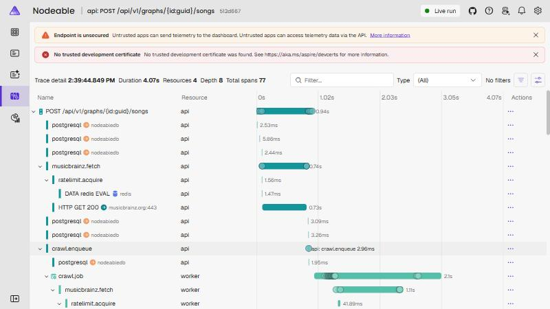

# LG-03: The graph UI

## 1. What was built

**Requirements delivered:** FR-SEARCH-01, FR-SEARCH-02, FR-GRAPH-01, FR-GRAPH-02, FR-GRAPH-03, FR-GRAPH-04, FR-HUB-01, FR-HUB-02, FR-HUB-03, NFR-A11Y-01, NFR-A11Y-02, NFR-SEC-02 (rate limits on the new endpoints), NFR-PERF-03 (the worker; see the note on phones in section 8), NFR-PERF-04 (the Lighthouse check). Decisions 0010 and 0011 were implemented here, 0013 was reviewed, and 0018 and 0019 were made.

Milestone M3 is where the product becomes visible. A person types a song, sees the original with its remasters and live takes folded behind it, adds it to their graph, and watches the producers, writers, engineers and musicians appear as the Worker finds them. People credited on two or more songs grow, are listed as hubs, and can be filtered by role. Everything the canvas shows is also in two real tables, so a keyboard and a screen reader get the same data.

Under it, four things are new on the server: a search endpoint that asks the cache first and MusicBrainz second (through the same Redis rate gate as the Worker), the graph endpoints with an anonymous token that is stored only as a hash, one SignalR hub whose events carry a per-graph sequence number, and a persistent local database. On the client: a TanStack Query cache that SignalR events write into, a D3 force layout that runs in a Web Worker for large graphs, a canvas renderer with quadtree hit testing, and a workspace layout with panels and bottom sheets.

Along the way the milestone also: pinned CI to `ubuntu-24.04`, found and fixed a gap in my own test harness (the 17th test factory shared a Redis database with an earlier one), and added a Lighthouse job. What was found only by running the real stack is in section 7.

## 2. Architecture slice

Only what M3 touched. Solid arrows are requests, dashed arrows are pushed events.

```text
Browser ──GET /search/recordings──► Api ──► recordings (pg_trgm)  ─ enough? ─► answer
   │                                  └──► Redis rate gate ──► MusicBrainz (only when the cache is short)
   │
   ├──POST /graphs, /graphs/{id}/songs ──► Api ──► graph_songs + crawl_jobs (kind=recording)
   │                                          │
   │                                          └──► Worker ──► MusicBrainz ──► credits, works, releases
   │                                                    │
   │      ┌──────── Redis backplane ◄── signalr.broadcast (seq = INCR per graph) ───┘
   │      ▼
   └◄┄┄ /hubs/graph (JoinGraph(graphId, token)) ┄┄ CreditsResolved, SongStatusChanged, HubsUpdated,
                                                    CrawlProgress, CrawlFailed
   │
   └──GET /graphs/{id} ──► snapshot { seq, songs, people, credits, hubs, crawl }

In the page:  hub event ──► applyGraphEvent ──► TanStack Query cache ──► canvas, hubs panel, tables
```

The order that matters is the one on the left: **join the group, then load the snapshot**, and the snapshot's `seq` says which events it already contains (section 4.1).

## 3. Code map

Generated with `tools/learning/collect-anchors LG-03`. Links point to the commit above, so they never go stale.
Do not edit between the two markers: `tools/learning/build` replaces the table with a fresh one pinned to the release commit every time the PDF is built.

<!-- code-map:start -->

| Anchor | File and lines | What it does | Concept it teaches |
| --- | --- | --- | --- |
| `typed-results-union` | [`src/Nodeable.Api/Endpoints/SearchEndpoints.cs#L33-L42`](https://example.invalid) | | |

<!-- code-map:end -->

## 4. Annotated walkthrough

### 4.1 `seq-before-snapshot` and `join-then-load`: not missing an event

Two pieces of code, one on each side, that together make "connect, load, stay current" correct.

```csharp
// GraphService.GetSnapshotAsync (server)
var seq = await events.CurrentSeqAsync(graphId, cancellationToken);

var songs = await read.GetSongsAsync(graphId, cancellationToken);
var credits = await read.GetCreditsAsync(songs.Select(s => s.Mbid).ToList(), cancellationToken);
var people = await read.GetPeopleAsync(credits.Select(c => c.PersonMbid), cancellationToken);
var hubItems = await read.GetHubsAsync(graphId, cancellationToken);
var crawl = await read.GetCrawlProgressAsync(graphId, cancellationToken);

return new GraphSnapshot(graph.Id, graph.Name, seq, songs, people, credits, hubItems, crawl);
```

```ts
// useLiveGraph (client)
queryFn: async ({ signal }) => {
  const snapshot = await fetchGraphSnapshot(session, signal)
  const newer = events.current.filter((event) => event.seq > snapshot.seq)
  events.current = newer
  return replayEvents(snapshot, newer)
},
```

- **`CurrentSeqAsync` first:** the Api reads the graph's event counter *before* it reads the data. Anything numbered above it is either newer than the snapshot or already inside it, and the client may apply it again harmlessly. Read after the data, and an event that happened between the two reads would be in neither.
- **The counter is Redis `INCR`:** one number per graph, taken before each message is sent, so the Api and the Worker (two processes) never use the same number and the order of the numbers is the order they were taken in.
- **`enabled: ready` in the hook:** the query does not run until the page has joined the graph's group. Loading first and subscribing afterwards leaves a gap in which events are lost.
- **`events.current` is a log, not a queue:** every event received is kept (up to 1000), and when a snapshot arrives the ones newer than it are replayed on top. Events that arrive while the snapshot is loading are therefore not lost, and a reconnect (which joins again and reloads) works the same way.
- **What would break:** swapping the order on the server loses events silently; applying events without the `seq` check double-counts nothing (the merge is idempotent) but makes a stale event overwrite fresher data such as the crawl progress.
- **How it is tested:** `FR_GRAPH_02_the_snapshot_reports_the_number_of_the_last_event_so_a_client_can_drop_older_ones` (server) and, on the page, `FR_GRAPH_02 joins the graph before it loads the snapshot, with the token as an argument` (a slow join must not be overtaken by the request) and `FR_GRAPH_02 keeps an event that arrives while the snapshot is loading`.

### 4.2 `strongly-typed-hub` and `redis-backplane`: a push from another process

```csharp
// GraphHub
public interface IGraphClient
{
    Task CreditsResolved(CreditsResolvedMessage message);
    Task SongStatusChanged(SongStatusChangedMessage message);
    Task HubsUpdated(HubsUpdatedMessage message);
    Task CrawlProgress(CrawlProgressMessage message);
    Task CrawlFailed(CrawlFailedMessage message);
}

public sealed class GraphHub(IGraphAccess access) : Hub<IGraphClient>
{
    public async Task JoinGraph(Guid graphId, string token)
    {
        var result = await access.CheckAsync(graphId, token, Context.ConnectionAborted);
        if (result != GraphAccessResult.Allowed)
        {
            throw new HubException("The graph was not found, or the token is not valid for it.");
        }

        await Groups.AddToGroupAsync(Context.ConnectionId, GroupName(graphId), Context.ConnectionAborted);
    }
}
```

```csharp
// GraphEventPublisher.BroadcastAsync (called by the Api and by the Worker)
var seq = await Database.StringIncrementAsync(SeqKey(graphId));
// ...
await send(hub.Clients.Group(GraphHub.GroupName(graphId)), seq);
```

- **`Hub<IGraphClient>`:** the messages the server may send are an interface, so `group.HubsUpdated(message)` is checked by the compiler. A Socket.IO server sends the string `"HubsUpdated"` and finds a typo at runtime.
- **The token is a method argument:** a browser's WebSocket cannot set a header and a token in the URL would reach logs (decision 0019). It travels in the body of the `JoinGraph` message, inside TLS in production.
- **One refusal message for two causes:** an unknown graph and a wrong token give the same text, so the hub does not confirm which graph ids exist (`FR_GRAPH_01_an_unknown_graph_is_refused_with_the_same_message_as_a_wrong_token`).
- **`Clients.Group` and the backplane:** `Clients.Group(...)` reaches only the connections held by *this* process. The Worker has no hub and no browser; with the Redis backplane the message is published to Redis, every Api instance receives it and delivers it to its own connections. That is how a job finishing in the Worker reaches a browser.
- **How it is tested:** a real SignalR client against the real Api over a real Redis, `FR_GRAPH_02_a_browser_that_joined_receives_the_events_in_sequence` and `FR_GRAPH_02_a_browser_only_hears_about_the_graph_it_joined`.

### 4.3 `discriminated-union` and the reducer: events as data

```ts
// graphEvents.ts
export type GraphEvent =
  | { type: 'CreditsResolved'; seq: number; songMbid: string; people: GraphPerson[]; credits: Omit<GraphCredit, 'songMbid'>[] }
  | { type: 'SongStatusChanged'; seq: number; songMbid: string; creditsStatus: SongStatus }
  | { type: 'HubsUpdated'; seq: number; hubs: GraphHub[] }
  | { type: 'CrawlProgress'; seq: number; queued: number; done: number; failed: number; etaSeconds: number }
  | { type: 'CrawlFailed'; seq: number; songMbid: string; reason: string }

export function applyGraphEvent(snapshot: GraphSnapshot, event: GraphEvent): GraphSnapshot {
  if (event.seq <= snapshot.seq) {
    return snapshot
  }

  switch (event.type) {
    case 'CreditsResolved': { /* merge people and credits by (song, person, role, detail) */ }
    case 'SongStatusChanged':
      return { ...snapshot, songs: snapshot.songs.map((song) =>
        song.mbid === event.songMbid ? { ...song, creditsStatus: event.creditsStatus } : song) }
    case 'HubsUpdated':
      return { ...snapshot, hubs: event.hubs }
    case 'CrawlProgress':
      return { ...snapshot, crawl: { queued: event.queued, done: event.done, failed: event.failed, etaSeconds: event.etaSeconds } }
    case 'CrawlFailed':
      return snapshot
    default: {
      const unreachable: never = event
      return unreachable
    }
  }
}
```

- **`type` is a literal:** inside `case 'HubsUpdated'` the compiler knows `event` is the `HubsUpdated` member, so `event.hubs` exists and `event.queued` is an error.
- **`never` in `default`:** add a sixth event to the union and this function stops compiling until it handles it. A JavaScript `switch` would fall through silently.
- **Returns a new object, never mutates:** React Query decides to re-render by reference, and the same object is returned when nothing changed (the `seq` guard), so a replayed event costs no render.
- **Idempotent:** the same event twice gives the same graph (`FR_GRAPH_03 gives the same graph when the same event is applied twice`), which is what makes the replay in 4.1 safe.
- **It is a Redux reducer:** `(state, action) => state`, with the discriminant called `type`. The difference is where the data lives: TanStack Query's cache, written to with `setQueryData` (the `set-query-data` anchor), instead of a store you wrote.

### 4.4 `web-worker`: the simulation off the page's thread

```ts
// layoutProtocol.ts: the worker's whole behaviour, with no reference to the worker scope
export function createLayoutWorkerHandler(post: Post): (message: ToLayoutWorker) => void {
  let generation = 0
  let layout: GraphLayout | null = null

  return (message) => {
    if (message.type === 'dispose') { layout?.stop(); layout = null; return }

    generation = message.gen
    layout ??= new GraphLayout(
      (nodes) => {
        const xy = new Float32Array(nodes.length * 2)
        nodes.forEach((node, index) => { xy[index * 2] = node.x; xy[index * 2 + 1] = node.y })
        post({ type: 'tick', gen: generation, xy }, [xy.buffer])
      },
      () => post({ type: 'settled', gen: generation }),
    )

    layout.update(message.input)
    post({ type: 'layout', gen: generation, ids: message.input.nodes.map((node) => node.id) })
  }
}
```

```ts
// layout.worker.ts (the only file that touches the worker's global scope)
const handle = createLayoutWorkerHandler((message, transfer = []) => scope.postMessage(message, transfer))
scope.onmessage = (event) => handle(event.data)
```

- **The page and the worker share nothing but messages.** The worker has no DOM and its own globals, like a separate Node process with a browser's message API.
- **`[xy.buffer]` is a transfer, not a copy:** the typed array's memory moves to the page; the worker no longer has it. The worker ticks about forty times a second, and 600 nodes are about five kilobytes a tick: copying that would be the page doing part of the work the worker was meant to take.
- **`ids` are sent once per update,** and each tick is only two floats per node. `gen` is a generation number: a tick of a graph the page has since replaced is dropped by the engine.
- **The handler is a plain function** that takes `post`, so `layoutProtocol.test.ts` runs it in Node without a worker (`NFR_PERF_03 hands each tick's buffer over instead of copying it`, `NFR_PERF_03 stamps later messages with the generation of the latest update`).
- **Same class on both sides:** `GraphLayout` knows nothing about threads. Below 500 nodes the page runs it inline; above, the worker does, and the page hands the new engine the positions the nodes already have so nothing scatters (`WORKER_NODE_THRESHOLD` in `layoutEngine.ts`).

### 4.5 `trigram-similarity`: cache first, MusicBrainz second

```csharp
// RecordingSearchService.SearchCacheAsync
var query = db.Recordings.AsNoTracking().Where(r => EF.Functions.TrigramsAreSimilar(r.Title, title));

if (!string.IsNullOrWhiteSpace(artist))
{
    var pattern = $"%{EscapeLike(artist.Trim())}%";
    query = query.Where(r => EF.Functions.ILike(r.ArtistCredit, pattern, LikeEscape));
}

var rows = await query
    .Select(r => new { Recording = r, Similarity = EF.Functions.TrigramsSimilarity(r.Title, title) })
    .OrderByDescending(x => x.Similarity)
    .Take(limit)
    .ToListAsync(cancellationToken);
```

- **`TrigramsAreSimilar` is `%`:** the `pg_trgm` operator, which the GIN index on `recordings.title` answers without reading every row. `TrigramsSimilarity` scores the matches so the best come first.
- **A cache hit is only used when it fills a page:** when the cache yields ten groups after duplicates are folded, MusicBrainz is not asked at all (decision 0018); otherwise MusicBrainz is asked for a window of 30 recordings (`FetchLimit`), whose results are collapsed and returned in place of the cache's (a short cache might hide a song MusicBrainz knows).
- **The `ILike` overload with an explicit escape:** the two-argument `ILike` is sent with `ESCAPE ''`, which turns the backslashes of `EscapeLike` into literal text. A test with an artist containing `%` found it; the escape character is passed explicitly now.
- **Collapsing duplicates is pure domain code** (`DuplicateCollapser`, no database): it groups by normalised title and artist after stripping "(Live ...)" and "- Remaster" decorations, keeps remixes and edits as their own songs, and picks the original as the earliest official non-live, non-compilation release (the `FR_SEARCH_02_*` tests in `DuplicateCollapserTests`).

## 5. New concepts from a JavaScript point of view

### C# and ASP.NET Core ideas

| Concept | In JavaScript / Node.js | In this code | Key difference |
| --- | --- | --- | --- |
| Typed server-to-client messages | `io.to(room).emit('HubsUpdated', payload)`; the name is a string | `Hub<IGraphClient>`: `Clients.Group(g).HubsUpdated(message)` | The compiler checks the name and the payload; the same interface is the contract |
| Scale-out for push | Socket.IO's Redis adapter | `AddStackExchangeRedis` backplane | The Worker, a different process with no browser, can send to a group through Redis |
| Rate limiting | `express-rate-limit` middleware | `AddRateLimiter` with a partitioned fixed window per client address; `.RequireRateLimiting("search")` on the endpoint | Built into the framework; the partition key is where "per address" is decided |
| Constant-time comparison | `crypto.timingSafeEqual` | `CryptographicOperations.FixedTimeEquals` on the SHA-256 of the token | Same idea; the Api stores only the hash, so a database leak does not leak tokens |
| Injectable time | `Date.now()` mocked with fake timers | `TimeProvider`, with `FakeTimeProvider` in tests | `Task.Delay(wait, time)` uses the injected clock, so the "at most once a second" debounce is tested without sleeping |
| Typed endpoint results | `res.status(404).json(...)` | `Results<Ok<T>, ProblemHttpResult>` | The possible answers are part of the method's type and of the OpenAPI document |
| Raw SQL with typed rows | `knex.raw(...)` / `pg` `query` | `db.Database.SqlQuery<T>(...)` | Columns map by name, so with the snake_case convention the SQL must alias them (`added_at`) |

### TypeScript, React and the browser

| Concept | In JavaScript | In this code | Key difference |
| --- | --- | --- | --- |
| Discriminated union | `switch (action.type)` with nothing checking it | `GraphEvent`, `never` in `default` | The compiler narrows the payload and fails on a missing case |
| External state in React | `store.subscribe` plus `useState` | `useSyncExternalStore(subscribe, getSnapshot)` for the `localStorage` session | Safe under concurrent rendering; `getSnapshot` must return the same object until the data changes |
| Server state from a socket | dispatch an action to a Redux store | `queryClient.setQueryData(key, applyGraphEvent)` | The cache is the store; components just `useQuery` |
| UI state | Redux slices | Zustand: `create((set) => ({ selectedId, select }))` | A hook, no provider, no action types; used for selection and role filters |
| Threads | `worker_threads` with `postMessage` | `Worker` with `new URL('./layout.worker.ts', import.meta.url)` | Same model (messages, transferables); Vite bundles the worker file as its own chunk |
| Canvas drawing | SVG with D3 selections and data joins | `drawGraph(ctx, scene)`: a pure function that paints one frame | D3 supplies the maths (forces, zoom, quadtree, scales); React owns the DOM; nothing re-renders while the graph moves |
| Hit testing | loop over nodes | `d3-quadtree` visit with pruning | A handful of squares instead of every node on every mouse move |

### Four small things that are no longer anchors

Four ideas came up and were demoted to ordinary comments so that the guide stays at about fifteen anchors. They are still in the code: `[GeneratedRegex]` on a partial method in `DuplicateCollapser` (the compiler writes the matcher at build time), `skipToken` as a `queryFn` in `useGraphSongIds` (a query that observes the cache and never fetches), the guarded and type-checked read of `localStorage` in `graphSession.ts` (parse into `unknown`, then check the fields), and the search URL as state in `SearchForm.tsx`.

### The concept that is least like JavaScript: a request that is not the whole answer

In a Node server you would probably return the data and let the client subscribe afterwards. Here the server hands out a snapshot *and a number that says how old it is*, and the client is expected to have subscribed first. The idea is a sequence number on a stream: anything with a larger number is news, anything with a number at or below it is already in the picture. Once you see the snapshot as "the stream up to `seq`", the order in section 4.1 stops being a trick and becomes the only correct one.

## 6. Run it and break it

**Run it:**

```bash
dotnet run --project src/Nodeable.AppHost
```

Open the web address the Aspire dashboard lists for `web`. The local database now survives a restart (decision 0011). `node tools/dev/reset-local-db.mjs --yes` empties it.

1. Search for *Redbone* with the artist *Childish Gambino*. One row has the 2016 original, and "Show 6 other versions" opens the live, remaster and compilation takes. The radio edit and the remixes keep their own rows.
2. Choose **Add to graph** on the original, then on *This Is America*. The node appears at once; credits stream in; the status line says how many lookups are waiting.
3. *Donald Glover* and *Ludwig Göransson* are credited on both songs: they are larger, outlined and listed under "Your hubs". Switch **Vocal** off: the vocal chips disappear from the tables and the canvas, and the hubs list is worked out again from the credits that remain, so a person whose only shared credits were vocals would leave it.
4. Reload the page: the graph comes back from `localStorage` and the server, and the page joins the group again before it loads the snapshot.

**Tests that cover it:**

- Server: `FR_GRAPH_02_a_browser_that_joined_receives_the_events_in_sequence`, `FR_GRAPH_01_joining_with_the_wrong_token_is_refused_and_receives_nothing`, `FR_HUB_02_hubs_updated_is_sent_at_once_the_first_time_then_at_most_once_a_second`, `FR_GRAPH_02_a_status_is_announced_when_it_changes_and_not_again_while_it_stays_the_same`, `NFR_SEC_02_one_address_cannot_add_more_songs_than_its_limit_in_a_minute`, `FR_SEARCH_02_remixes_and_edits_are_different_recordings_and_keep_their_own_row`, `NFR_RATE_03_a_musicbrainz_that_keeps_answering_503_makes_adding_a_503_with_retry_after`.
- Page: `graphEvents.test.ts` (the reducer), `graph.test.tsx` (add, join order, event during load, reconnect, hub down), `forceLayout.test.ts`, `hitTest.test.ts`, `layoutProtocol.test.ts`, `hubs.test.tsx` (filters, hubs, collapse, sheets).

**Break it on purpose:**

1. **Change:** in `GraphEventPublisher.SongStatusChangedAsync`, delete the early `return false` when the status is unchanged. **Expected failure:** `FR_GRAPH_02_a_status_is_announced_when_it_changes_and_not_again_while_it_stays_the_same` and `FR_GRAPH_02_a_status_remembered_from_the_add_answer_is_not_announced_again`. **What it teaches:** events that are idempotent for the page are still wasteful on the wire, and the server remembers the last status it announced per graph.
2. **Change:** in `useLiveGraph`, set `enabled: true` instead of `enabled: ready`. **Expected failure:** `FR_GRAPH_02 joins the graph before it loads the snapshot, with the token as an argument`. **What it teaches:** the join-then-load rule is about ordering, which an instant fake does not show; the test holds the join and asserts that no snapshot request is made meanwhile.
3. **Change:** in `applyGraphEvent`, replace the `event.seq <= snapshot.seq` guard with `false`. **Expected failure:** `FR_GRAPH_02 ignores an event at or below the snapshot seq, which the snapshot already contains`. **What it teaches:** the `seq` is what lets the page replay safely.
4. **Change:** remove `.RequireRateLimiting(ApiRateLimiting.SongAdditionPolicy)` from the add-song endpoint. **Expected failure:** `NFR_SEC_02_one_address_cannot_add_more_songs_than_its_limit_in_a_minute`.

## 7. Read the trace

The screenshot is one click on "Add to graph" for a recording the cache had never seen, in the Aspire dashboard: one trace, 77 spans, 4.07 s, crossing the Api and the Worker.



| Span | What happened | Typical duration |
| --- | --- | --- |
| `POST /api/v1/graphs/{id}/songs` (api) | The request: token check, graph size, the song's row, the MusicBrainz lookup, the queued job | 0.94 s |
| `musicbrainz.fetch` (api) | The Api confirms an unknown recording with MusicBrainz (decision 0019) | 0.74 s |
| `ratelimit.acquire` and its Redis `EVAL` | The shared gate: one Lua script, one slot | 1.6 ms and 1.5 ms |
| `HTTP GET musicbrainz.org` | The only part that is the network | 0.73 s |
| `crawl.enqueue` (api) | The `recording` job is inserted with the request's trace context | 3 ms |
| `crawl.job` (worker) | The Worker continues the same trace: recording, then follow-up jobs | 2.1 s for the first job |
| `signalr.broadcast` | One per event sent (not on screen: below the fold) | a few ms each |

Read it from top to bottom: the request is short because it queues work and returns `202`; the Worker's `crawl.job` is a child of the same trace, so one view shows the click and everything it caused. The two MusicBrainz lookups (one in the request, one in the job) are the cost decision 0019 accepted.

## 8. Decisions and trade-offs

| Decision | Alternatives considered | Why this one | Decision record |
| --- | --- | --- | --- |
| The Api searches MusicBrainz itself, through the shared gate, with a short wait cap | Queue every search as a job; let the browser call MusicBrainz | Search needs an answer in the request; a wait cap turns "gate busy" into `429 Retry-After` instead of a hung click | `docs/spec/decisions/0018-search-calls-musicbrainz-from-the-api.md` |
| Add a song by MBID alone; confirm unknown recordings with MusicBrainz | Trust the title and artist in the request body | A client-written title would sit in the shared cache and appear in other people's search | `docs/spec/decisions/0019-add-by-mbid-and-hub-token-argument.md` |
| The hub token is a method argument | `access_token` in the URL; a cookie | WebSockets cannot set headers; URLs reach logs; no tracking cookies (NFR-PRIV-01) | `docs/spec/decisions/0019-add-by-mbid-and-hub-token-argument.md` |
| Anonymous graph token stored as a SHA-256 hash, compared in constant time | Store the token; sign a JWT | A database leak must not hand out graphs; no key management | `docs/spec/decisions/0007-anonymous-graph-tokens-are-hashed.md` |
| `other` role in neutral grey, with its own filter chip | Hide unmapped relationships | Hiding credits hides data; the detail text is the label | `docs/spec/decisions/0010-other-role-is-shown-neutrally.md` |
| Local database in a named Docker volume with a remembered password | Throw-away container each run | MusicBrainz allows about one request a second, so fetching again after every restart costs real time | `docs/spec/decisions/0011-persistent-local-database.md` |
| Click selects a node and opens a panel from graph data only | Fetch the person's recordings now | The fetched drawer is M4's (FR-PERSON-01); M3 stays within what the snapshot holds | none (agreed in the milestone plan) |
| Layout in a Web Worker above 500 nodes | Always inline; always a worker | Small graphs avoid a thread hop; large ones keep the page responsive. A phone has **not** been measured: NFR-PERF-03's 30 fps there is still to be checked on a device | spec section 12 |

## 9. Interview talking points

- **30-second version:** the graph is a server-side snapshot plus a stream of events. The page joins the stream first, loads the snapshot, and replays anything newer, because every event carries a per-graph sequence number. The same cache feeds a D3 canvas, a hubs panel and accessible tables.
- **2-minute version:** a song is added by id; the Api confirms it with MusicBrainz through a Redis rate gate shared with the Worker, queues one job, and answers `202`. The Worker fetches credits at one request a second and, after each job, publishes events through a Redis backplane to the browsers in that graph's SignalR group. The page applies each event to its query cache with a pure reducer. People credited on two songs are hubs, computed again from whichever roles are switched on.
- **Deep dive:** the ordering problem. Naive "load then subscribe" loses events in the gap; "subscribe then load" can double-apply them. Making events idempotent and numbering them lets the page do the second safely. What I would do at 100x: the counter is one Redis key per graph, which is fine; the hub's group fan-out is what would need sharding, and the snapshot query would need caching per `seq`.
- **A question they might ask, and your answer:** *Why not just poll `GET /graphs/{id}`?* At one crawl job per second per user, polling is either slow (the graph feels dead) or wasteful (most polls return nothing). Push also lets the server say "failed: here is why" at the moment it happens. The snapshot endpoint is still needed for the first load and for reconnects.
- **Another:** *How do you know the 500-node worker threshold is right?* On this machine a tick of 600 nodes took 2.4 ms and a frame 0.4 ms, which is comfortable even inline. The threshold exists for phones, several times slower, and I have not measured one; the spec says so and the number is a constant in one file.

## 10. Exercises

Attempt these without looking anything up first.

1. **Persist the role filters in `localStorage`.** The store is `stores/roleFilters.ts`; reuse the guarded read from `graphSession.ts`. · Hint: `useSyncExternalStore` is not needed if you only read once at creation.
2. **Add an event `SongRemoved` to the hub.** Server: a new method on `IGraphClient`. Client: a new member of `GraphEvent`. Let the compiler tell you what else to change. · Hint: the `never` check in `applyGraphEvent` and the `graphEventTypes` list.
3. **Show how stale a snapshot is.** Display the number of events applied since the last load. · Hint: `events.current` in `useLiveGraph` already has them.
4. **Stretch: make the hub's `HubsUpdated` send only what changed.** What does the client need in order to apply a diff, and what happens at a reconnect? · Hint: think about `seq` gaps.

## 11. Further reading

- [ASP.NET Core SignalR hubs](https://learn.microsoft.com/aspnet/core/signalr/hubs): strongly typed hubs, groups, and the lifetime of a hub instance.
- [Redis backplane for SignalR](https://learn.microsoft.com/aspnet/core/signalr/redis-backplane): what the backplane does and what it does not (it does not store messages).
- [Rate limiting middleware](https://learn.microsoft.com/aspnet/core/performance/rate-limit): the four limiter algorithms and partitioning.
- [`TimeProvider`](https://learn.microsoft.com/dotnet/api/system.timeprovider): the abstraction `FakeTimeProvider` replaces in tests.
- [PostgreSQL `pg_trgm`](https://www.postgresql.org/docs/current/pgtrgm.html): similarity, the `%` operator and index support.
- [d3-force](https://d3js.org/d3-force): the simulation, `alpha`, and why it stops itself.
- [`queryClient.setQueryData`](https://tanstack.com/query/latest/docs/framework/react/reference/QueryClient#queryclientsetquerydata): writing to the cache from outside a query.
- [`useSyncExternalStore`](https://react.dev/reference/react/useSyncExternalStore): subscribing to state that is not React's.
- [Using Web Workers](https://developer.mozilla.org/docs/Web/API/Web_Workers_API/Using_web_workers): messages and transferable objects.
- [Lighthouse CI](https://github.com/GoogleChrome/lighthouse-ci): assertions and the `staticDistDir` collector.

## 12. Check yourself

Ten short questions covering this guide. Answer each in a sentence or two before opening the answers.

1. Why does the Api read the graph's `seq` before it reads the songs and credits?
2. Why must the page join the hub's group before it loads the snapshot?
3. What makes it safe to apply an event the snapshot already contains?
4. Why is the graph token sent as an argument of `JoinGraph` and not in the hub's URL?
5. Why can the Worker send to a browser even though it has no hub of its own?
6. What does the `never` assignment in `applyGraphEvent` protect you from?
7. When does the search skip MusicBrainz entirely, and what does it do when the gate is busy?
8. Why are hubs worked out again on the page when a role is switched off, instead of read from the snapshot?
9. What is transferred, not copied, when the layout runs in the worker, and why does it matter?
10. The "credits incomplete" badge ignores the role filters. Why?

### Answers

1. The counter is a promise about the data: an event numbered above it is either newer than the snapshot or already inside it. Read after the data, an event that landed between the two reads would be in neither.
2. Loading first and subscribing afterwards leaves a gap in which events are neither in the snapshot nor received. Joining first, then loading, and replaying everything newer than the snapshot's `seq` closes it.
3. Every event is idempotent: credits merge by (song, person, role, detail), a status is a replacement, hubs and progress are replacements. Applying twice gives the same graph, and events at or below the snapshot's `seq` are dropped anyway.
4. A browser's WebSocket cannot set request headers, and a URL ends up in proxy and server logs, where the spec forbids tokens. A method argument travels in the body of the message, inside TLS.
5. The Api's hub is connected to Redis as a backplane. The Worker publishes through the same `IHubContext` and the message reaches every Api instance, which delivers it to the connections it holds for that group.
6. A new event type added to the union without a matching `case`: the assignment to `never` fails to compile, so the reducer cannot silently ignore it.
7. When the cache already yields a full page (ten groups after duplicates are folded). When the shared gate has no slot within the short wait cap, the Api answers `429` with `Retry-After` instead of holding the request; MusicBrainz errors that persist are `503`.
8. The server's hub list counts every credit. With a role off, a person credited on two songs only in that role is no longer a hub, and the list must follow the filter; deriving from the credits that remain does that.
9. The positions array's buffer. Transferring moves its memory to the page without copying, so a tick of hundreds of nodes costs the page nothing more than reading it.
10. The badge says the song has neither a producer nor a songwriter at all. Switching vocals off must not make a complete song look incomplete, so it is judged from every credit.
